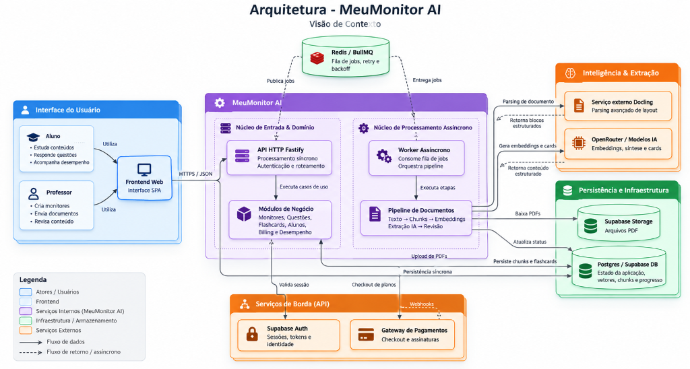

# Architecture — MeuMonitor AI

## 1. Objetivo da arquitetura

Este documento define a arquitetura técnica inicial do MeuMonitor AI.

O objetivo é permitir um MVP rápido de lançar, mas com fundações corretas para escalar sem reescrever o núcleo do produto.

O sistema deve suportar:

- múltiplos professores;
- múltiplos agentes por professor;
- bases de conhecimento organizadas por categoria e subcategoria;
- banco de questões revisado pelo professor;
- chat com IA restrito às fontes do agente;
- assinatura por agente;
- rastreamento de desempenho do aluno;
- simulados personalizados;
- processamento assíncrono de arquivos;
- isolamento multi-tenant forte.

O sistema não deve ser modelado como marketplace público. A navegação pública pode ter uma landing institucional para professores e uma entrada simples para alunos, mas a compra/assinatura do aluno deve acontecer no contexto de uma página pública de professor.

## 2. Princípios técnicos

### 2.1 Começar simples, mas modular

O MVP deve evitar microserviços prematuros. A recomendação é iniciar com uma aplicação web modular, separando domínios internos com clareza.

Essa abordagem reduz custo operacional e complexidade inicial, mas preserva caminho para extrair serviços no futuro.

Domínios que devem nascer bem separados no código:

- auth e perfis;
- professores;
- alunos;
- agentes;
- conteúdo;
- questões;
- chat/RAG;
- pagamentos;
- desempenho;
- simulados;
- processamento assíncrono;
- observabilidade e custos de IA.

### 2.2 Multi-tenant por padrão

Todo dado sensível deve estar vinculado a um professor, agente ou assinatura.

As principais entidades devem carregar identificadores como:

- `teacher_id`;
- `agent_id`;
- `student_id`;
- `subscription_id`.

Consultas de conteúdo e RAG nunca devem depender apenas de filtros no prompt. O isolamento deve acontecer no banco e na camada de aplicação.

### 2.3 IA auditável

Toda chamada de IA relevante deve registrar:

- usuário;
- professor;
- agente;
- operação;
- modelo;
- provedor;
- tokens de entrada;
- tokens de saída;
- custo estimado;
- status;
- erro, quando houver.

No chat, mesmo que o aluno não veja as fontes, o sistema deve registrar internamente quais chunks/documentos foram usados.

### 2.4 Custos observáveis desde o primeiro dia

Custos não serão tratados como uma etapa posterior de analytics. Toda operação que possa gerar custo deve nascer com rastreabilidade suficiente para responder:

- quanto cada aluno consumiu;
- qual operação gerou o consumo;
- qual modelo/provedor foi utilizado;
- quanto a IA custou;
- quanto a infraestrutura custou no mesmo período;
- qual é o custo aproximado por assinatura e a margem estimada.

No MVP, o custo de infraestrutura pode ser lançado por período a partir das faturas e painéis dos fornecedores. A arquitetura deve permitir substituir esse lançamento manual por integração automática no futuro.

### 2.4 Conteúdo aprovado antes de uso

Questões extraídas por IA não devem entrar automaticamente na prática do aluno.

O fluxo correto é:

1. IA extrai;
2. professor revisa;
3. professor aprova;
4. questão entra no banco ativo.

## 3. Stack recomendada

### 3.1 Frontend e aplicação web

- Next.js;
- TypeScript;
- Tailwind CSS;
- shadcn/ui ou biblioteca equivalente;
- React Hook Form;
- Zod para validação;
- TanStack Query ou Server Actions, dependendo do padrão escolhido no projeto.

O app deve ser web responsivo primeiro.

Aplicativo mobile nativo fica fora do MVP.

### 3.2 Backend

Recomendação para o MVP:

- Next.js como aplicação principal;
- API Routes/Route Handlers para endpoints;
- Server Actions para fluxos internos simples;
- módulos internos bem separados por domínio.

Para processamento assíncrono:

- usar workers separados em Node.js;
- rodar via processo separado na VPS;
- comunicar por filas/tabelas de jobs no banco inicialmente.

No futuro, os workers podem virar serviços separados sem alterar o modelo de domínio.

### 3.3 Banco de dados e autenticação

Supabase será usado para:

- Auth;
- Postgres;
- Storage inicialmente, caso seja habilitado no projeto;
- pgvector, se a busca vetorial ficar dentro do Postgres;
- RLS nas tabelas expostas.

Mesmo usando Supabase Auth, a aplicação deve manter tabelas próprias para perfis de professor e aluno.

### 3.4 Hospedagem

Existem duas opções viáveis.

#### Opção recomendada para MVP robusto

- Next.js na Vercel;
- Supabase gerenciado;
- worker em Railway/Render/Fly.io/VPS;
- storage no Supabase ou S3-compatible.

Vantagem: menor carga operacional no início.

#### Opção compatível com VPS

- VPS com Docker Compose;
- container `web` para Next.js;
- container `worker` para processamento assíncrono;
- reverse proxy com Caddy ou Nginx;
- Supabase gerenciado para Auth/Database;
- logs coletados por serviço externo ou arquivos estruturados inicialmente.

Recomendação pragmática: se a preferência é VPS, usar Docker Compose desde o início, mas manter Supabase gerenciado. Evitar hospedar Postgres crítico manualmente no MVP.

## 4. Arquitetura lógica



```text
Aluno/Professor
      |
      v
Next.js Web App
      |
      |---- Supabase Auth
      |
      |---- Supabase Postgres
      |
      |---- Supabase Storage / Object Storage
      |
      |---- Payment Gateway
      |
      |---- OpenRouter
                 |
                 |---- Modelos de chat
                 |---- Modelos de extração/classificação
                 |---- Modelos de embeddings, se aplicável

Worker assíncrono
      |
      |---- Processamento de PDFs
      |---- Compressão/normalização
      |---- Extração de texto
      |---- Extração de questões
      |---- Geração de embeddings
      |---- Atualização de status
```

## 5. Módulos do sistema

### 5.1 Auth e perfis

Responsável por:

- login;
- cadastro;
- sessão;
- vínculo entre usuário autenticado e papéis internos;
- identificação de professor/aluno.

Tabelas principais:

- `profiles`;
- `teachers`;
- `students`.

### 5.2 Professores

Responsável por:

- cadastro do professor;
- status de aprovação;
- página pública;
- slug;
- dados comerciais básicos.

### 5.3 Taxonomia

Responsável por:

- categorias;
- subcategorias;
- organização do conhecimento.

A subcategoria é a unidade central de associação de conteúdo.

### 5.4 Conteúdo

Responsável por:

- arquivos originais;
- materiais processados;
- chunks;
- metadados;
- status de processamento;
- vínculo com subcategorias.

### 5.5 Questões

Responsável por:

- questões extraídas;
- questões cadastradas manualmente;
- alternativas;
- gabaritos;
- explicações;
- revisão e aprovação.

### 5.6 Agentes

Responsável por:

- criação de agentes;
- seleção de subcategorias;
- publicação;
- controle de escopo do chat e das questões.

### 5.7 Assinaturas

Responsável por:

- assinatura mensal por agente;
- status de acesso;
- integração com gateway;
- webhooks;
- histórico de pagamentos.

O gateway ainda será decidido. A arquitetura deve abstrair o provedor para permitir Stripe, Mercado Pago, Asaas ou Pagar.me.

### 5.8 Chat/RAG

Responsável por:

- receber pergunta do aluno;
- validar assinatura ativa;
- identificar agente;
- recuperar chunks autorizados;
- montar contexto;
- chamar modelo via OpenRouter;
- registrar resposta;
- registrar fontes internas.

### 5.9 Desempenho

Responsável por:

- tentativas de questões;
- acertos e erros;
- desempenho por categoria/subcategoria;
- tempo de resposta;
- histórico usado para simulados.

### 5.10 Simulados

Responsável por:

- gerar simulados com questões existentes;
- priorizar subcategorias fracas;
- priorizar questões nunca respondidas;
- incluir questões erradas anteriormente;
- registrar resultado.

### 5.11 Desafio diário e ranking

Responsável por:

- selecionar uma questão diária por agente;
- registrar respostas;
- calcular ranking mensal por quantidade de acertos.

Ranking deve usar apelido/nickname do aluno, não necessariamente nome real.

## 6. Modelo de dados inicial

### 6.1 Usuários e papéis

#### `profiles`

Representa o usuário autenticado.

Campos sugeridos:

- `id`;
- `auth_user_id`;
- `full_name`;
- `nickname`;
- `email`;
- `created_at`;
- `updated_at`.

#### `teachers`

Campos sugeridos:

- `id`;
- `profile_id`;
- `display_name`;
- `slug`;
- `bio`;
- `area`;
- `status`;
- `created_at`;
- `updated_at`.

Status:

- `pending`;
- `approved`;
- `rejected`;
- `suspended`.

#### `students`

Campos sugeridos:

- `id`;
- `profile_id`;
- `created_at`;
- `updated_at`.

### 6.2 Taxonomia

#### `categories`

Campos sugeridos:

- `id`;
- `teacher_id`;
- `name`;
- `description`;
- `status`;
- `created_at`;
- `updated_at`.

#### `subcategories`

Campos sugeridos:

- `id`;
- `teacher_id`;
- `category_id`;
- `name`;
- `description`;
- `status`;
- `created_at`;
- `updated_at`.

Status:

- `active`;
- `archived`.

### 6.3 Agentes

#### `agents`

Campos sugeridos:

- `id`;
- `teacher_id`;
- `name`;
- `slug`;
- `description`;
- `objective`;
- `status`;
- `monthly_price_cents`;
- `created_at`;
- `updated_at`.

Status:

- `draft`;
- `published`;
- `disabled`.

#### `agent_subcategories`

Tabela de vínculo entre agentes e subcategorias.

Campos sugeridos:

- `id`;
- `agent_id`;
- `subcategory_id`;
- `created_at`.

### 6.4 Materiais e processamento

#### `documents`

Campos sugeridos:

- `id`;
- `teacher_id`;
- `subcategory_id`;
- `uploaded_by_profile_id`;
- `title`;
- `original_filename`;
- `storage_path`;
- `compressed_storage_path`;
- `mime_type`;
- `file_size_bytes`;
- `file_hash`;
- `status`;
- `processing_error`;
- `created_at`;
- `updated_at`.

Status:

- `uploaded`;
- `queued`;
- `processing`;
- `processed`;
- `failed`;
- `archived`.

#### `document_chunks`

Campos sugeridos:

- `id`;
- `teacher_id`;
- `document_id`;
- `subcategory_id`;
- `chunk_index`;
- `content`;
- `metadata`;
- `embedding`;
- `created_at`.

Observação: se pgvector for usado, `embedding` será um campo vetorial. Se um vector database externo for usado no futuro, manter `external_vector_id`.

#### `processing_jobs`

Campos sugeridos:

- `id`;
- `teacher_id`;
- `document_id`;
- `job_type`;
- `status`;
- `attempts`;
- `last_error`;
- `created_at`;
- `started_at`;
- `finished_at`.

Tipos:

- `compress_document`;
- `extract_text`;
- `extract_questions`;
- `generate_embeddings`.

Status:

- `queued`;
- `running`;
- `succeeded`;
- `failed`;
- `cancelled`.

### 6.5 Questões

#### `questions`

Campos sugeridos:

- `id`;
- `teacher_id`;
- `subcategory_id`;
- `source_document_id`;
- `statement`;
- `explanation`;
- `question_type`;
- `difficulty`;
- `exam_board`;
- `exam_year`;
- `status`;
- `ai_confidence`;
- `created_at`;
- `updated_at`.

Status:

- `draft`;
- `pending_review`;
- `approved`;
- `archived`.

#### `question_options`

Campos sugeridos:

- `id`;
- `question_id`;
- `label`;
- `content`;
- `is_correct`;
- `sort_order`.

#### `answer_keys`

Opcional no MVP se gabarito for tratado diretamente nas opções.

Campos sugeridos:

- `id`;
- `teacher_id`;
- `document_id`;
- `raw_content`;
- `parsed_content`;
- `status`;
- `created_at`;

### 6.6 Assinaturas e pagamentos

#### `subscriptions`

Campos sugeridos:

- `id`;
- `student_id`;
- `teacher_id`;
- `agent_id`;
- `gateway`;
- `gateway_subscription_id`;
- `status`;
- `price_cents`;
- `discount_cents`;
- `current_period_start`;
- `current_period_end`;
- `created_at`;
- `updated_at`.

Status:

- `trialing`;
- `active`;
- `past_due`;
- `cancelled`;
- `expired`;

#### `payments`

Campos sugeridos:

- `id`;
- `subscription_id`;
- `student_id`;
- `teacher_id`;
- `agent_id`;
- `gateway`;
- `gateway_payment_id`;
- `amount_cents`;
- `status`;
- `paid_at`;
- `created_at`.

Status:

- `pending`;
- `paid`;
- `failed`;
- `refunded`;
- `chargeback`.

#### `commission_entries`

Campos sugeridos:

- `id`;
- `teacher_id`;
- `payment_id`;
- `amount_cents`;
- `status`;
- `available_at`;
- `created_at`.

Status:

- `pending`;
- `available`;
- `paid`;
- `cancelled`.

Mesmo que o split automático não esteja definido, registrar comissões desde o começo evita perda de histórico.

### 6.7 Estudo e desempenho

#### `question_attempts`

Campos sugeridos:

- `id`;
- `student_id`;
- `teacher_id`;
- `agent_id`;
- `question_id`;
- `selected_option_id`;
- `is_correct`;
- `response_time_ms`;
- `source`;
- `created_at`.

Source:

- `practice`;
- `daily_challenge`;
- `simulation`;

#### `student_subcategory_stats`

Tabela derivada/cache para desempenho.

Campos sugeridos:

- `id`;
- `student_id`;
- `agent_id`;
- `subcategory_id`;
- `attempts_count`;
- `correct_count`;
- `wrong_count`;
- `accuracy`;
- `last_attempt_at`;
- `updated_at`.

### 6.8 Chat

#### `chat_sessions`

Campos sugeridos:

- `id`;
- `student_id`;
- `teacher_id`;
- `agent_id`;
- `title`;
- `created_at`;
- `updated_at`.

#### `chat_messages`

Campos sugeridos:

- `id`;
- `session_id`;
- `role`;
- `content`;
- `related_question_id`;
- `created_at`.

Roles:

- `user`;
- `assistant`;
- `system`.

#### `chat_retrievals`

Registra fontes usadas internamente.

Campos sugeridos:

- `id`;
- `chat_message_id`;
- `document_chunk_id`;
- `score`;
- `created_at`.

### 6.9 Simulados

#### `simulations`

Campos sugeridos:

- `id`;
- `student_id`;
- `teacher_id`;
- `agent_id`;
- `type`;
- `status`;
- `created_at`;
- `completed_at`.

Type:

- `weekly`;
- `monthly`;

Status:

- `generated`;
- `in_progress`;
- `completed`;
- `expired`.

#### `simulation_questions`

Campos sugeridos:

- `id`;
- `simulation_id`;
- `question_id`;
- `sort_order`;
- `selection_reason`.

### 6.10 Desafio diário

#### `daily_challenges`

Campos sugeridos:

- `id`;
- `teacher_id`;
- `agent_id`;
- `question_id`;
- `challenge_date`;
- `created_at`.

#### `daily_challenge_attempts`

Campos sugeridos:

- `id`;
- `daily_challenge_id`;
- `student_id`;
- `selected_option_id`;
- `is_correct`;
- `created_at`.

### 6.11 IA e custos

#### `ai_usage_logs`

Campos sugeridos:

- `id`;
- `teacher_id`;
- `student_id`;
- `agent_id`;
- `operation`;
- `provider`;
- `model`;
- `input_tokens`;
- `output_tokens`;
- `estimated_cost_cents`;
- `status`;
- `error`;
- `created_at`.

Operations:

- `chat`;
- `extract_questions`;
- `classify_content`;
- `generate_embeddings`;
- `explain_question`;
- `generate_simulation`;

Regras:

- registrar uma linha por chamada efetiva ao provedor;
- persistir tokens informados pelo provedor; quando indisponíveis, registrar estimativa e a origem da estimativa;
- persistir a tabela de preços/versionamento usada no cálculo;
- nunca calcular custo apenas no frontend;
- permitir agregação diária e mensal por aluno, professor, agente e operação.

### 6.12 Custos de infraestrutura e economia unitária

#### `infrastructure_costs`

Registro dos custos reais de serviços externos e infraestrutura própria.

Campos sugeridos:

- `id`;
- `period_start`;
- `period_end`;
- `provider` — Supabase, VPS, compute, storage, bandwidth, observabilidade etc.;
- `service`;
- `environment` — development, staging ou production;
- `amount_cents`;
- `currency`;
- `source` — invoice, provider_api ou manual;
- `metadata`;
- `created_at`.

#### `cost_allocation_snapshots`

Snapshot agregado para análise sem alterar o log bruto.

Campos sugeridos:

- `id`;
- `period_start`;
- `period_end`;
- `student_id`, quando aplicável;
- `teacher_id`;
- `agent_id`, quando aplicável;
- `ai_cost_cents`;
- `infrastructure_cost_cents`;
- `total_cost_cents`;
- `active_subscription_days`;
- `calculation_version`;
- `created_at`.

A alocação de infraestrutura será inicialmente rateada por aluno ativo ou por assinatura ativa, com a regra registrada em `calculation_version`. Isso permite trocar a metodologia sem perder histórico.

## 7. RLS e autorização

### 7.1 Regras gerais

- RLS deve ser habilitado em tabelas expostas.
- O frontend nunca deve receber chave de serviço.
- Operações administrativas e processamento assíncrono devem usar contexto server-side.
- Autorização baseada em papel deve usar dados internos confiáveis, não metadados editáveis pelo usuário.

### 7.2 Professor

Professor pode:

- ler e editar seus próprios dados;
- gerenciar suas categorias;
- gerenciar suas subcategorias;
- enviar materiais próprios;
- revisar questões próprias;
- criar agentes próprios;
- ver dados agregados dos alunos dos seus agentes.

Professor não pode:

- acessar materiais de outro professor;
- acessar dados individuais sensíveis fora dos seus agentes;
- alterar assinaturas manualmente pelo frontend.

### 7.3 Aluno

Aluno pode:

- ver agentes publicados;
- acessar agentes assinados;
- resolver questões de agentes assinados;
- acessar chat de agentes assinados;
- ver seu próprio desempenho.

Aluno não pode:

- acessar documentos brutos do professor;
- acessar chunks;
- acessar questões de agentes não assinados;
- acessar dados de outros alunos.

### 7.4 Plataforma/Admin

No MVP, admin completo fica fora de escopo.

Ainda assim, o banco deve prever:

- status de professor;
- status de agente;
- status de assinatura;
- capacidade de intervenção manual via banco.

## 8. Processamento de documentos

### 8.1 Fluxo principal

1. Professor seleciona subcategoria.
2. Professor envia arquivo.
3. Sistema valida tipo e tamanho.
4. Sistema calcula hash.
5. Sistema salva arquivo original.
6. Sistema gera versão comprimida quando aplicável.
7. Sistema cria `document`.
8. Sistema cria `processing_job`.
9. Worker processa arquivo.
10. Worker extrai texto.
11. Worker separa chunks.
12. Worker gera embeddings.
13. Worker tenta extrair questões, se o arquivo for prova/lista.
14. Questões entram como `pending_review`.
15. Professor revisa e aprova.

### 8.2 OCR

OCR não deve ser dependência obrigatória do MVP.

O sistema deve ser preparado para receber OCR depois, mas o primeiro recorte pode priorizar PDFs com texto extraível.

Estratégia:

- tentar extração textual primeiro;
- se texto extraído for insuficiente, marcar documento como `needs_ocr`;
- professor/admin decide reprocessar com OCR no futuro.

### 8.3 Imagens e tabelas

O MVP deve converter o máximo possível para texto.

Questões com imagem/tabela podem ser aceitas com suporte parcial:

- preservar referência ao documento original;
- extrair texto ao redor;
- marcar baixa confiança;
- exigir revisão manual.

Não é obrigatório resolver perfeitamente todos os formatos no primeiro ciclo.

## 9. RAG e chat

### 9.1 Fluxo do chat

1. Aluno envia pergunta.
2. Sistema valida sessão.
3. Sistema valida assinatura ativa para o agente.
4. Sistema identifica `teacher_id` e `agent_id`.
5. Sistema lista subcategorias vinculadas ao agente.
6. Sistema busca chunks somente dessas subcategorias.
7. Sistema monta contexto.
8. Sistema chama modelo via OpenRouter.
9. Sistema salva pergunta e resposta.
10. Sistema salva chunks usados em `chat_retrievals`.
11. Sistema registra custo em `ai_usage_logs`.

### 9.2 Restrições

O chat deve responder somente com base nas fontes do professor.

Se o contexto recuperado for fraco, a resposta deve informar que não há base suficiente para responder com segurança.

No MVP, o aluno não verá citações ou fontes.

Internamente, fontes devem ser registradas para auditoria.

### 9.3 Perguntas sobre questões

Quando o aluno perguntar sobre uma questão específica, o sistema deve incluir no contexto:

- enunciado;
- alternativas;
- alternativa escolhida pelo aluno, se houver;
- resposta correta;
- explicação cadastrada;
- chunks relacionados à subcategoria.

## 10. Seleção de questões

### 10.1 Prática

Critérios de seleção:

- questões aprovadas;
- dentro das subcategorias do agente;
- preferir questões nunca respondidas;
- permitir revisão de questões erradas.

### 10.2 Simulado personalizado

O simulado deve usar questões existentes.

Critérios:

- calcular desempenho por subcategoria;
- identificar subcategorias com menor acurácia;
- selecionar mais questões dessas subcategorias;
- priorizar questões nunca respondidas;
- incluir questões erradas anteriormente;
- evitar repetir questões recentes quando possível.

IA pode apoiar explicações e análise, mas não deve criar questões inéditas no MVP.

## 11. Pagamentos

### 11.1 Decisão em aberto

O gateway ainda será escolhido.

Requisitos para escolha:

- suportar assinatura recorrente;
- funcionar bem no Brasil;
- suportar split de pagamentos ou facilitar repasse ao professor;
- webhooks confiáveis;
- boa documentação;
- suporte a cupom/desconto ou plano beta;
- custo operacional aceitável.

Opções a avaliar:

- Stripe;
- Mercado Pago;
- Asaas;
- Pagar.me.

### 11.2 Abstração recomendada

Criar uma camada interna de pagamentos com interface própria.

Conceitos internos:

- `createCheckout`;
- `handleWebhook`;
- `cancelSubscription`;
- `getSubscriptionStatus`;
- `refundPayment`, futuro.

Assim, trocar gateway no futuro não exige reescrever o domínio inteiro.

### 11.3 Beta com desconto

Enquanto o gateway não for decidido, modelar desconto no banco:

- `price_cents`;
- `discount_cents`;
- `coupon_code`, opcional futuramente.

## 12. OpenRouter e IA

### 12.1 Provedor

OpenRouter será usado como camada de acesso a múltiplos modelos.

Motivo:

- flexibilidade de modelos;
- possibilidade de trocar modelo por operação;
- controle de custo;
- fallback entre modelos.

### 12.2 Tipos de operação

Operações simples:

- classificação de conteúdo;
- extração inicial;
- sugestão de categoria;
- normalização de questão.

Operações mais sensíveis:

- chat com aluno;
- explicação de questão;
- relatório/simulado personalizado.

### 12.3 Embeddings

Decisão em aberto:

- usar embeddings via OpenAI diretamente;
- usar embeddings por provider disponível no OpenRouter, se suportado de forma adequada;
- usar outro provider específico para embeddings.

Recomendação: tratar embeddings como serviço interno abstrato, para permitir troca de modelo.

## 13. Deploy e ambientes

### 13.1 Ambientes

Ambientes mínimos:

- local;
- staging;
- production.

### 13.2 Variáveis de ambiente

Separar:

- Supabase URL;
- Supabase public key;
- Supabase service role key apenas server-side;
- OpenRouter API key;
- gateway payment keys;
- storage config;
- app URL;
- webhook secrets.

Nenhuma chave sensível deve ser exposta no frontend.

### 13.3 Docker

Se usar VPS, estrutura recomendada:

- `web`: Next.js;
- `worker`: jobs assíncronos;
- `proxy`: Caddy/Nginx;
- `redis`, opcional no futuro para fila;
- Supabase gerenciado fora da VPS.

No MVP, é aceitável usar tabela `processing_jobs` no Postgres como fila simples. Para escala, migrar para fila dedicada.

## 14. Observabilidade

No MVP, registrar no banco:

- erros de processamento;
- logs de IA;
- consumo de tokens por operação;
- custo estimado de IA por chamada;
- custos reais de infraestrutura por fornecedor e período;
- snapshots de custo por aluno, professor, agente e assinatura;
- status de assinatura;
- tentativas de questões;
- eventos importantes do aluno.

Eventos úteis:

- `teacher_signed_up`;
- `agent_published`;
- `document_uploaded`;
- `document_processed`;
- `question_approved`;
- `student_subscribed`;
- `question_answered`;
- `chat_message_sent`;
- `simulation_completed`;
- `daily_challenge_answered`.

Indicadores mínimos desde V0:

- tokens de entrada e saída por operação;
- custo de IA por aluno e por assinatura;
- custo mensal de Supabase, compute/worker, storage e bandwidth;
- custo total por aluno ativo;
- custo variável, custo fixo rateado e margem estimada;
- consumo e custo que excederem os limites definidos.

Ferramentas externas podem ser adicionadas depois:

- Sentry;
- PostHog;
- Grafana/Prometheus;
- Logtail/Better Stack.

## 15. Estrutura sugerida do repositório

```text
meumonitor-ai/
  apps/
    web/
      app/
      components/
      modules/
      lib/
  workers/
    processor/
  packages/
    database/
    ai/
    payments/
    shared/
  supabase/
    migrations/
    seed.sql
  docs/
    PRD.md
    ARCHITECTURE.md
```

Para começar mais simples, também é aceitável iniciar com:

```text
app/
components/
modules/
lib/
supabase/
docs/
```

Mas a separação por `apps/`, `workers/` e `packages/` facilita crescer para serviços separados.

## 16. Ordem recomendada de implementação

### Etapa 1 — Fundação técnica

- inicializar Next.js;
- configurar TypeScript;
- configurar Supabase;
- configurar Auth;
- criar schema inicial;
- habilitar RLS;
- criar layouts básicos.

### Etapa 2 — Professor e agentes

- cadastro de professor;
- status no banco;
- página pública;
- categorias;
- subcategorias;
- criação de agentes;
- publicação de agente.

### Etapa 3 — Upload e processamento

- upload de PDF;
- salvar arquivo original/comprimido;
- criar job;
- worker processa texto;
- gerar chunks;
- salvar chunks;
- gerar embeddings.

### Etapa 4 — Questões

- extração inicial por IA;
- tela de revisão;
- aprovação;
- banco de questões por subcategoria.

### Etapa 5 — Aluno e assinatura

- cadastro/login de aluno;
- assinatura de agente;
- validação de acesso;
- área do aluno.

### Etapa 6 — Estudo

- prática de questões;
- registro de tentativas;
- explicação de questão;
- chat RAG.

### Etapa 7 — Diagnóstico

- estatísticas por subcategoria;
- desafio diário;
- ranking mensal;
- simulado personalizado.

## 17. Decisões pendentes

Antes da implementação completa, ainda devem ser fechadas:

- gateway de pagamento;
- uso inicial de Vercel ou VPS;
- provider/modelo de embeddings;
- limite inicial de mensagens do chat;
- política de comissão;
- regras detalhadas de reprocessamento;
- regras de remoção/arquivamento de conteúdo;
- tamanho padrão de simulados;
- critérios exatos para cálculo de desempenho.

## 18. Recomendação final

A arquitetura recomendada é uma aplicação modular em Next.js com Supabase gerenciado para Auth e Postgres, worker assíncrono separado para processamento, OpenRouter como camada de IA e abstração própria para pagamentos.

Evitar microserviços completos no MVP reduz complexidade operacional. A separação por módulos, workers e pacotes internos entrega quase o mesmo benefício estrutural, mas com menos risco de atrasar a validação comercial.
