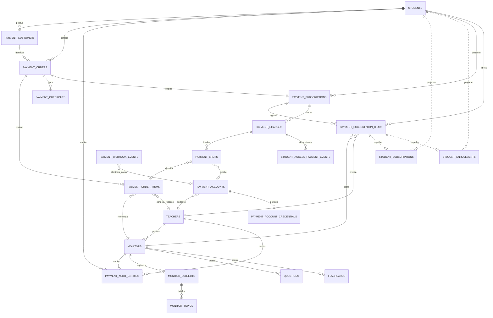

# Pagamentos, assinaturas e acesso

Documento de referência do fluxo implementado em 25/09/2026. O provedor financeiro é o Asaas. O backend é a única camada autorizada a falar com o Asaas; o frontend recebe apenas DTOs seguros.

## 1. Regra principal

O Asaas é a autoridade externa para cobrança, assinatura, pagamento e split. As tabelas `payment_*` são a representação financeira canônica local. As tabelas `student_*` são projeções de compatibilidade/acesso e o snapshot de acesso do aluno é servido por `EntitlementService` e Redis.

Nenhum módulo de aluno deve decidir acesso consultando diretamente uma tabela legada. O contrato canônico é `GET /api/v1/student/access`. O resultado contém monitores liberados, assinatura, período de acesso, permissões, matérias, contagens aprovadas, capa do monitor e imagens do professor. Redis usa `entitlement:v1:{environment}:{studentId}` com TTL de 60 segundos.

## 2. Tabelas financeiras atuais

| Tabela | Responsabilidade |
|---|---|
| `payment_accounts` | Conta Asaas/subconta do professor: `provider_account_id`, `wallet_id`, ambiente e status de onboarding. |
| `payment_customers` | Relação entre aluno e customer do Asaas. |
| `payment_orders` | Pedido financeiro local, aluno, checkout, moeda, valor e estado do pedido. |
| `payment_order_items` | Monitores do pedido, professor, preço e percentuais congelados no momento da compra. |
| `payment_checkouts` | Sessão de checkout, `provider_checkout_id`, URL, tentativa e idempotência. |
| `payment_subscriptions` | Assinatura recorrente agregada por aluno/pedido, `provider_subscription_id`, ambiente, status e período atual. |
| `payment_subscription_items` | Cada monitor dentro da assinatura, com professor, preço, percentual e status individual. |
| `payment_charges` | Cobranças do Asaas: valor bruto, líquido, taxas, datas, período de serviço e status. |
| `payment_splits` | Resultado/regra do split por cobrança: wallet, papel, percentual, valor esperado/recebido e liquidação. |
| `payment_idempotency_keys` | Evita checkout ou cancelamento duplicado para a mesma operação. |
| `payment_webhook_events` | Inbox dos webhooks Asaas, com payload, tentativas, estado e correlação. |
| `payment_outbox_events` | Eventos financeiros internos para processamento assíncrono e retry. |
| `payment_audit_entries` | Auditoria de cancelamentos e alterações, com ator, monitor, antes/depois e data. |
| `student_access_payment_events` | Idempotência da aplicação de eventos financeiros que concedem/reconciliam acesso. |

Status importantes: `ACTIVE` libera acesso; `CANCEL_PENDING` mantém acesso até `currentPeriodEnd`; `CANCELLED` encerra a assinatura/item; `PAST_DUE` representa cobrança vencida. Webhooks possuem estados de recebimento, processamento, sucesso, espera de correlação e falha.

## 3. Projeções e conteúdo

| Tabela | Papel atual |
|---|---|
| `student_purchases` / `student_purchase_items` | Histórico legado de compras; não deve criar uma nova verdade financeira. |
| `student_subscriptions` | Projeção de compatibilidade de acesso por aluno/monitor. |
| `student_enrollments` | Projeção do vínculo de acesso ao conteúdo. |
| `billing_subscriptions` / `billing_subscription_items` / `billing_subscription_changes` | Modelo antigo de billing; não é a fonte do novo fluxo Asaas. |
| `monitors` | Produto vendido, incluindo `avatar_url`, professor, publicação e preço de catálogo. |
| `teachers` | Professor recebedor, incluindo `avatar_url`, `banner_url` e percentual padrão. |
| `monitor_subjects` / `monitor_topics` | Estrutura pedagógica exibida no snapshot. |
| `questions` / `flashcards` | Conteúdo; o snapshot conta somente registros `APPROVED`. |

## 4. Componentes do backend

### Checkout e pagamento

- `CreateCheckoutUseCase`: valida monitor/preço, cria pedido idempotente e solicita checkout recorrente ao provider.
- `PaymentCheckoutRepository`: persiste pedido, itens, checkout e vínculos para correlacionar o retorno do Asaas.
- `AsaasCheckoutProvider`: adapter do checkout hospedado; o frontend apenas redireciona para a URL retornada.
- `AsaasHttpClient`: autenticação, timeout, tratamento de erro e chamadas HTTP ao Asaas.

### Assinaturas e cancelamento

- `PaymentSubscriptionRepository`: lê assinatura/item financeiro pertencente ao aluno, histórico e auditoria.
- `PaymentSubscriptionService`: cancela somente o item solicitado; reduz a recorrência quando restam itens ou executa `DELETE` no Asaas quando é o último. Usa `Idempotency-Key`.
- `AsaasSubscriptionProvider`: chama o Asaas para atualizar/cancelar a recorrência.

Endpoint:

```http
DELETE /api/v1/student/subscriptions/:subscriptionId/items/:monitorId
Idempotency-Key: <chave-única>
```

O acesso continua válido até `endsAt/currentPeriodEnd`, a auditoria é gravada e o snapshot Redis é invalidado.

### Webhooks

- `AsaasWebhookController`: recebe o webhook sem sessão de usuário e valida `asaas-access-token`.
- `AsaasWebhookIngress`: salva o evento na inbox e enfileira o processamento.
- `ProcessPaymentWebhookUseCase`: garante claim/idempotência e escolhe a aplicação pelo tipo do evento.
- `PaymentEventRepository`: aplica confirmação, recebimento, overdue, refund, chargeback e eventos de assinatura.

`PAYMENT_CONFIRMED`/`PAYMENT_RECEIVED` persistem cobrança e split, ativam assinatura/item e atualizam projeções de acesso. `SUBSCRIPTION_DELETED` marca assinatura/item como cancelados e atualiza as projeções com o fim do período. Webhook duplicado não pode duplicar cobrança, split, acesso ou auditoria.

### Acesso e cache

- `PaymentEntitlementRepository`: consulta `payment_*`, monitores, professor, matérias, tópicos e contagens aprovadas.
- `EntitlementService`: filtra status/período, deduplica monitores e constrói permissões de agente, questões, flashcards, desafios, chat, desempenho e ranking.
- `RedisEntitlementCache`: cacheia o snapshot por aluno por 60 segundos e faz fallback ao banco quando Redis falha.

A capa vem de `monitors.avatar_url`; o avatar e banner do professor vêm de `teachers.avatar_url` e `teachers.banner_url`.

### Repasses

- `TeacherPayoutRepository`: consulta cobranças e splits por professor.
- `TeacherPayoutService`: calcula recebido/pendente usando valores reais do Asaas.
- `PaymentAccountController`: expõe overview seguro e link para o painel oficial do Asaas; nunca expõe API key.

O percentual do split do Asaas é aplicado ao valor líquido (`netValue`). A resposta/webhook do Asaas prevalece sobre estimativas locais.

## 5. Fluxos completos

### Compra aprovada

1. O aluno inicia checkout.
2. O backend cria `payment_order`, itens e checkout.
3. O aluno paga no Asaas.
4. O Asaas envia webhook para `POST /api/v1/payments/webhooks/asaas`.
5. A inbox salva o evento e o worker processa uma única vez.
6. O backend persiste cobrança e split.
7. Assinatura/item tornam-se ativos.
8. Projeções `student_subscription`/`student_enrollment` são atualizadas.
9. O snapshot do aluno é invalidado.
10. A próxima consulta a `/student/access` lê o banco e repopula Redis.

### Cancelamento de um monitor

1. O aluno clica no botão daquele monitor.
2. O frontend envia `DELETE` com token e idempotência.
3. O backend valida ownership e item ativo.
4. O Asaas reduz a recorrência ou cancela a assinatura inteira se for o último.
5. O item local fica `CANCEL_PENDING` e a auditoria é gravada.
6. O aluno continua acessando até `currentPeriodEnd`.
7. O histórico mostra a data do pedido e `endsAt`.
8. Webhook/reconciliação confirma o estado final.

## 6. Endpoints relevantes

| Endpoint | Função |
|---|---|
| `POST /api/v1/payments/checkout` | Cria checkout Asaas. |
| `POST /api/v1/payments/webhooks/asaas` | Recebe eventos Asaas. |
| `GET /api/v1/student/access` | Snapshot canônico de acesso + cache. |
| `GET /api/v1/student/subscriptions` | Detalhe financeiro das assinaturas do aluno. |
| `GET /api/v1/student/subscriptions/history` | Auditoria de alterações/cancelamentos. |
| `DELETE /api/v1/student/subscriptions/:id/items/:monitorId` | Cancela item no Asaas. |
| `GET /api/v1/teachers/me/payment-account/overview` | KPIs e estado da conta de recebimento. |

## 7. Consultas de diagnóstico

```sql
SELECT id, student_id, provider_subscription_id, environment, status,
       current_period_start, current_period_end, cancel_at_period_end,
       cancelled_at
FROM payment_subscriptions ORDER BY updated_at DESC;
```

```sql
SELECT id, subscription_id, monitor_id, teacher_id, status,
       price_cents_snapshot, teacher_percentage_snapshot
FROM payment_subscription_items ORDER BY updated_at DESC;
```

```sql
SELECT provider_payment_id, status, gross_cents, net_cents, fee_cents,
       service_period_start, service_period_end
FROM payment_charges ORDER BY created_at DESC;
```

```sql
SELECT payment_charge_id, provider_split_id, role, wallet_id,
       expected_cents, settled_cents, status
FROM payment_splits ORDER BY updated_at DESC;
```

Para investigar acesso, compare `/api/v1/student/access` com `payment_subscription_items`. Não use somente `student_subscriptions` ou `student_enrollments` para concluir que uma cobrança Asaas está ativa.

## 8. Configuração e segurança

```text
PAYMENTS_PROVIDER=ASAAS
ASAAS_ENV=sandbox|production
ASAAS_API_KEY=<somente backend>
ASAAS_WEBHOOK_AUTH_TOKEN=<somente backend>
ASAAS_CREDENTIAL_ENCRYPTION_KEY=<base64 de exatamente 32 bytes; somente backend/secret manager>
NEXT_PUBLIC_API_URL=<URL pública do backend>
```

Sandbox e produção são separados também para as credenciais cifradas: uma credencial nunca é lida nem persistida fora do ambiente da conta. A criação da subconta guarda apenas `ciphertext`, nonce, tag e versão; overview descriptografa somente no backend; rotação substitui a credencial anterior de forma idempotente. Nunca registrar API key, `access_token`, ciphertext, token de webhook ou dados completos de cartão em logs/documentação. O frontend não chama o Asaas diretamente e nenhuma variável `ASAAS_*` pode usar o prefixo `NEXT_PUBLIC_`.

### Runbook de credenciais de subconta

1. Gere uma chave aleatória de 32 bytes e codifique em Base64; configure `ASAAS_CREDENTIAL_ENCRYPTION_KEY` apenas no backend/secret manager.
2. Confirme `ASAAS_ENV=sandbox` antes de validar uma conta Sandbox. Produção usa `ASAAS_ENV=production` e credencial própria.
3. Após criar a subconta, consulte `GET /api/v1/teachers/me/payment-account/overview`; a resposta não contém segredo.
4. Para trocar a chave da subconta, use `POST /api/v1/teachers/me/payment-account/credential/rotate` com `environment` e uma `operationKey` idempotente. Não cole a credencial em logs, tickets ou frontend.
5. Em revogação, use o endpoint de revoke; a exclusão local em cascata remove somente a credencial e não pagamentos, assinaturas nem histórico de alunos.

## 9. Limitações e próximos passos

- Projeções e tabelas legadas ainda existem e devem ser eliminadas após a migração definitiva.
- O painel do professor deve usar `payment_subscription_items` e `payment_splits` para listar alunos ativos e valores reais de repasse.
- Reconciliação periódica deve consultar o Asaas para corrigir eventos perdidos, principalmente cancelamentos e splits pendentes.

## 10. Arquivos principais

- `backend/prisma/schema.prisma`
- `backend/src/modules/payments/`
- `backend/src/modules/access/`
- `backend/src/modules/payments/infrastructure/persistence/payment-event.repository.ts`
- `backend/src/modules/payments/application/commands/process-webhook.use-case.ts`
- `frontend/src/modules/student/context/EntitlementProvider.tsx`
- `frontend/src/app/(student-app)/areadoaluno/planos/page.tsx`

## 11. ER do módulo de pagamentos

O diagrama abaixo separa o núcleo financeiro (`payment_*`), as projeções de acesso (`student_*`) e o catálogo pedagógico. A direção da seta representa a chave estrangeira; as tabelas legadas aparecem tracejadas para deixar explícito que não são a fonte de verdade do fluxo Asaas.



### Função de cada grupo

| Grupo | Tabelas | Função e regra de leitura |
|---|---|---|
| Identidade e catálogo | `teachers`, `students`, `monitors`, `monitor_subjects`, `monitor_topics`, `questions`, `flashcards` | Identifica as partes e descreve o produto. O catálogo não decide se o aluno pagou; ele apenas fornece o conteúdo associado ao monitor. |
| Pedido e checkout | `payment_customers`, `payment_orders`, `payment_order_items`, `payment_checkouts` | Registra a intenção de compra e a sessão hospedada pelo Asaas. Os snapshots de preço, professor e percentual preservam o contrato da compra. |
| Assinatura | `payment_subscriptions`, `payment_subscription_items` | É a fonte financeira local da assinatura. A assinatura agrupa o pedido; cada item representa um monitor e pode ser cancelado individualmente. |
| Cobrança | `payment_charges` | Representa cada cobrança recorrente do Asaas, com valor bruto, líquido, taxa, período e status. |
| Repasse | `payment_accounts`, `payment_account_credentials`, `payment_splits` | Guarda a conta Asaas do professor, a credencial cifrada e o resultado do split. O valor real do repasse vem do Asaas; percentuais locais são snapshots/contrato. |
| Sincronização | `payment_webhook_events`, `payment_outbox_events`, `student_access_payment_events` | Garante inbox, processamento assíncrono, retry e idempotência. Webhook repetido não duplica acesso, cobrança ou split. |
| Auditoria | `payment_audit_entries`, `payment_idempotency_keys` | Registra cancelamentos, alterações, ator, motivo, antes/depois e evita repetir comandos do aluno. |
| Acesso projetado | `student_subscriptions`, `student_enrollments` | Projeções de compatibilidade. Podem ser consultadas para suporte, mas os módulos do aluno devem usar `GET /api/v1/student/access`, derivado do núcleo financeiro e cacheado no Redis. |

### Relacionamento operacional

```text
Aluno
  -> payment_order
  -> payment_checkout
  -> payment_subscription
  -> payment_subscription_item (um por monitor)
  -> payment_charge (cada ciclo)
  -> payment_split (repasse ao professor)
  -> student_access_payment_event (idempotência da liberação)
  -> snapshot de acesso no Redis
```

### Regras de status e acesso

| Situação | Acesso do aluno | Repasse/financeiro |
|---|---|---|
| `ACTIVE` | Liberado enquanto o período atual estiver vigente. | Assinatura ativa. |
| `CANCEL_PENDING` | Continua liberado até `currentPeriodEnd`. | Não deve gerar nova cobrança após o cancelamento no Asaas. |
| `CANCELLED` | Bloqueado quando o período terminar ou se o provedor indicar encerramento imediato. | Assinatura encerrada; histórico preservado. |
| `PAST_DUE` | Aplicação da política de cobrança definida pelo produto. | Cobrança vencida, sem assumir que o split foi liquidado. |
| Split `AWAITING_CREDIT` | Não altera o acesso, que depende da cobrança confirmada. | Aparece como “A receber”; o overview consulta `/payments/splits/received?status=AWAITING_CREDIT`. |
| Split `DONE` | Não altera o acesso. | Considerado recebido/liquidado pelo Asaas. |

### Fonte externa para o painel do professor

O painel consulta a conta Asaas aprovada através de `GET /api/v1/teachers/me/payment-account/overview`. O backend consulta o Asaas e não expõe credenciais:

| Indicador | Fonte Asaas |
|---|---|
| Saldo disponível | `/finance/balance` |
| Recebido no mês | `/payments` filtrado por período/status de recebimento |
| A receber | `/payments/splits/received?status=AWAITING_CREDIT` usando `totalValue` |
| Transferências pendentes | `/transfers` paginado, filtrando localmente os status pendentes |

O painel também informa `Prazo estimado: 2 dias úteis`. Esse texto é uma estimativa operacional de crédito e não substitui o status retornado pelo Asaas. Para liquidação de split, o webhook `PAYMENT_SPLIT_DONE` é a confirmação preferencial.
