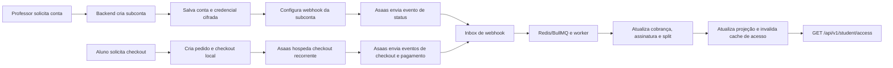

# Documentação do fluxo de pagamentos Asaas

Índice da integração do MeuMonitorAI com o Asaas: contas de recebimento, checkouts, cobranças, assinaturas, split, webhooks e acesso do aluno.

## Estado validado

Em 27/10/2026, o fluxo de checkout foi exercitado no Asaas Sandbox com API e worker locais, banco PostgreSQL e Redis descartáveis e ngrok temporário. `CHECKOUT_CREATED`, `CHECKOUT_PAID`, `PAYMENT_CREATED` e `PAYMENT_CONFIRMED` chegaram ao endpoint; o worker processou a confirmação como `PAYMENT_ACCESS_APPLIED`, e a matrícula de teste ficou ativa. O webhook temporário foi removido ao final.

Essa evidência valida uma compra Sandbox ponta a ponta. Não demonstra deploy ou comportamento em produção, nem valida uma jornada de criação/aprovação de subconta no Sandbox.

## Leia nesta ordem

1. [Referência do fluxo implementado](reference/PAGAMENTOS-E-ASSINATURAS.md) — checkout, webhooks, estados financeiros, acesso, cancelamento e tabelas.
2. [Configuração e variáveis](reference/CONFIGURACAO-E-VARIAVEIS.md) — variáveis, segredos, separação de ambientes e pontos de monitoramento.
3. [Status e sincronização da conta de recebimento](reference/asaas-account-status-sync.md) — criação da subconta, credencial cifrada e eventos `ACCOUNT_STATUS_*`.
4. [Melhorias e evidências de validação](MELHORIAS-ASAAS.md) — resultados verificados, limites e pendências para produção.

## Caminho ponta a ponta



## Organização

```text
docs/asaas/
├── README.md                              # este índice e status de validação
├── MELHORIAS-ASAAS.md                    # evidências, limitações e pendências
├── reference/                             # comportamento atual e operação
│   ├── PAGAMENTOS-E-ASSINATURAS.md
│   ├── CONFIGURACAO-E-VARIAVEIS.md
│   └── asaas-account-status-sync.md
├── specs/                                 # desenhos e decisões da implementação
└── plans/                                 # roteiros de trabalho históricos
```

As referências devem acompanhar o código. Specs e planos registram decisões da época em que foram escritos; seus requisitos podem ter sido implementados ou superados. Para responder como o sistema funciona hoje, use primeiro as referências e confira os arquivos citados nelas. A evidência Sandbox em `MELHORIAS-ASAAS.md` prevalece sobre pendências antigas descritas em specs/plans.

## Especificações e decisões históricas

- [Cobertura dos eventos de webhook](specs/2026-10-26-asaas-webhook-event-coverage-design.md)
- [Confiabilidade do webhook de subconta](specs/2026-10-25-asaas-subaccount-webhook-reliability-design.md)
- [Testes do fluxo de subconta](specs/2026-10-25-asaas-subaccount-flow-tests-design.md)
- [Armazenamento de credenciais da subconta](specs/2026-09-25-asaas-subaccount-credential-storage-design.md)
- [Checkout MVP](specs/2026-09-23-asaas-checkout-mvp-design.md)
- [Pagamentos como fonte única](specs/2026-09-24-pagamentos-asaas-fonte-unica-design.md)
- [Assinaturas, acesso e Redis](specs/2026-09-25-assinaturas-acesso-redis-asaas-design.md)
- [Resiliência do cancelamento](specs/2026-09-26-checkout-cancellation-resilience-design.md)
- [KPIs da conta](specs/2026-09-25-asaas-account-dashboard-kpis-design.md)
- [Recebimento Asaas](specs/2026-09-09-recebimento-asaas-design.md)

## Implementação em validação local

- [Vagas patrocinadas por professores e plano anual](../superpowers/specs/2026-10-27-sponsored-student-seats-and-annual-plan-design.md) — spec implementada; painel do professor, compra em lote sem split, checkout anual e vínculo por e-mail verificado. A integração ponta a ponta foi exercitada no banco local descartável com provider falso; ainda não houve teste Asaas Sandbox deste novo fluxo.

Consulte [o comportamento atualizado](reference/PAGAMENTOS-E-ASSINATURAS.md) para endpoints, regras de preço, estados e acesso. A lista de variáveis de ambiente permanece em [Configuração e variáveis](reference/CONFIGURACAO-E-VARIAVEIS.md); o recurso não adiciona segredos nem variáveis novas.

## Planos históricos

- [Cobertura de eventos](plans/2026-10-26-asaas-webhook-event-coverage.md)
- [Fluxo e testes de subconta](plans/2026-10-25-asaas-subaccount-flow.md)
- [Credenciais de subconta](plans/2026-09-25-asaas-subaccount-credential-storage.md)
- [KPIs da conta](plans/2026-09-25-asaas-account-dashboard-kpis.md)
- [Pagamentos como fonte única](plans/2026-09-24-pagamentos-asaas-fonte-unica.md)
- [Checkout MVP](plans/2026-09-23-asaas-checkout-mvp.md)
- [Payments Service e recebimento](plans/2026-09-09-payments-service-recebimento.md)

## Regra de atualização

Ao mudar eventos, estados, endpoints, schema ou regras de acesso, atualize a referência principal e o status de validação. Não marque um evento como configurado remotamente só porque ele existe no catálogo do código: confira separadamente o webhook no ambiente Asaas correspondente.
