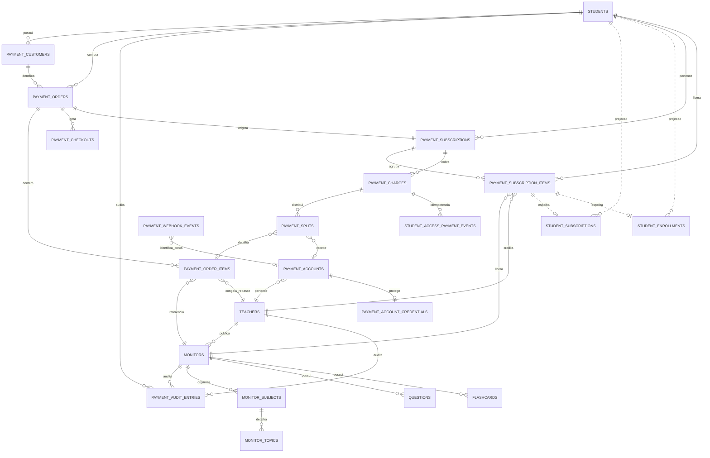

# Pagamentos, assinaturas e acesso

Referência do comportamento implementado no módulo de pagamentos, revisada em 01/11/2026. O backend é a única camada que chama o Asaas; os frontends recebem DTOs seguros e redirecionam para o checkout hospedado.

## 1. Regra principal

O Asaas é a autoridade externa para cobrança, assinatura, pagamento e liquidação de split. As tabelas `payment_*` são a representação financeira canônica local. `student_subscriptions` e `student_enrollments` são projeções de compatibilidade/acesso; o contrato usado pelos módulos do aluno é `GET /api/v1/student/access`, servido por `EntitlementService` com Redis como cache.

O snapshot contém monitores liberados, assinatura, período de acesso, permissões, matérias, contagens aprovadas, capa do monitor e imagens do professor. Redis usa `entitlement:v1:{environment}:{studentId}` com TTL de 60 segundos; as mutações financeiras invalidam o snapshot e a leitura consulta o banco quando não há cache válido.

## 2. Tabelas financeiras atuais

| Tabela | Responsabilidade |
|---|---|
| `payment_accounts` | Conta Asaas/subconta do professor: `provider_account_id`, `wallet_id`, ambiente e status de onboarding. |
| `payment_account_creation_operations` | Reserva/idempotência e reconciliação da criação remota da subconta. Evita repetir `POST /accounts` após resultado incerto. |
| `payment_account_credentials` | Credenciais das subcontas cifradas, vinculadas à conta e ambiente. |
| `payment_account_credential_operations` | Idempotência de rotação e revogação de credenciais. |
| `payment_customers` | Relação entre aluno e customer do Asaas. |
| `payment_orders` | Pedido financeiro local, aluno, checkout, moeda, valor e estado do pedido. |
| `payment_order_items` | Monitores do pedido, professor, preço e percentuais congelados no momento da compra. |
| `payment_checkouts` | Sessão de checkout, `provider_checkout_id`, URL, tentativa e idempotência. |
| `payment_subscriptions` | Assinatura recorrente agregada por aluno/pedido, `provider_subscription_id`, ambiente, status e período atual. |
| `payment_subscription_items` | Cada monitor dentro da assinatura, com professor, preço, percentual e status individual. |
| `payment_charges` | Cobranças do Asaas: valor bruto, líquido, taxas, datas, período de serviço e status. |
| `payment_splits` | Resultado/regra do split por cobrança: wallet, papel, percentual, valor esperado/recebido e liquidação. |
| `payment_idempotency_keys` | Evita checkout ou cancelamento duplicado para a mesma operação. |
| `payment_webhook_events` | Inbox durável dos webhooks Asaas, com identidade externa, payload, tentativas, estado e correlação. |
| `payment_outbox_events` | Registro transacional associado à entrada da inbox para entrega interna confiável. |
| `payment_audit_entries` | Auditoria de cancelamentos e alterações, com ator, monitor, antes/depois e data. |
| `student_access_payment_events` | Idempotência da aplicação de eventos financeiros que concedem/reconciliam acesso. |
| `sponsored_seat_batches` | Compra feita pelo professor para um monitor, guardando ambiente, intervalo, valores calculados, checkout e estado da cobrança. |
| `sponsored_seats` | Vagas por e-mail normalizado, com estado, estudante vinculado e período individual de acesso. |
| `sponsored_seat_payments` | Cobranças/renovações dos lotes mensais patrocinados, idempotentes por ambiente e ID de pagamento. |

O worker também pode marcar evento sem correlação como `WAITING_CORRELATION`; após o limite de tentativas, usa `DEAD_LETTER` para revisão operacional. A fila BullMQ usa tentativas com backoff; a rotina de recuperação do worker procura eventos recuperáveis periodicamente.

## 3. Projeções e conteúdo

| Tabela | Papel atual |
|---|---|
| `student_purchases` / `student_purchase_items` | Histórico legado de compras; não deve criar uma nova verdade financeira. |
| `student_subscriptions` | Projeção de compatibilidade de acesso por aluno/monitor. |
| `student_enrollments` | Projeção do vínculo de acesso ao conteúdo. |
| `billing_subscriptions` / `billing_subscription_items` / `billing_subscription_changes` | Modelo antigo de billing; não é a fonte do novo fluxo Asaas. |
| `monitors` | Produto vendido, incluindo `avatar_url`, professor, publicação e preço de catálogo. |
| `teachers` | Professor recebedor, incluindo `avatar_url`, `banner_url` e percentual padrão. |
| `monitor_subjects` / `monitor_topics` | Estrutura pedagógica exibida no snapshot. |
| `questions` / `flashcards` | Conteúdo; o snapshot conta somente registros `APPROVED`. |

## 4. Componentes do backend

### Checkout e pagamento

- `POST /api/v1/payments/checkout` exige sessão de aluno, `monitorId` UUID e `Idempotency-Key`. O body aceita `interval: MONTHLY | ANNUAL` e `billingType: CREDIT_CARD | PIX`; omissão mantém mensal e cartão para compatibilidade com clientes antigos. A vitrine pública exige escolha explícita do intervalo e método antes de abrir o checkout hospedado.
- Mensal com cartão cria cobrança `RECURRENT` mensal; mensal com Pix cria cobrança avulsa `DETACHED`, que libera um mês após `PAYMENT_CONFIRMED` ou `PAYMENT_RECEIVED` e exige renovação manual. Eventos de checkout, isoladamente, não liberam o acesso mensal.
- Anual aceita Pix à vista (`DETACHED`) ou cartão à vista/parcelado (`DETACHED` + `INSTALLMENT`, máximo de 12 parcelas). Ambos dão 12 meses; `CHECKOUT_PAID` ativa o acesso anual de forma idempotente. O backend calcula o anual como `preço mensal × 12 × 0,8`, arredonda para centavos e fornece o valor ao storefront e à cotação patrocinada.
- O checkout envia apenas o método escolhido. A idempotência diferencia método e intervalo; a vitrine não coleta dados de cartão nem gera QR Pix, redirecionando para o checkout hospedado.
- O preço é lido de `Monitor.priceCents` e congelado em `payment_orders`/`payment_order_items`; `PAYMENTS_TEST_PRICE_CENTS` não é usado nesse fluxo Asaas.
- O preço anual é derivado do preço mensal no backend; não existe coluna nem configuração anual no banco. A base é 12 mensalidades, com desconto anual de 20% sobre o total, igual para Pix e cartão; não há desconto Pix adicional.
- `PaymentCheckoutRepository`: persiste pedido, item, assinatura pendente, chave de idempotência e checkout para correlacionar eventos do Asaas.
- Se a chamada ao Asaas falhar, pedido e idempotência são marcados para retry. Se a sessão for criada remotamente e a persistência local falhar, o erro é registrado para reconciliação; o Asaas não deve ser chamado novamente às cegas.
- As compras diretas do aluno permanecem disponíveis mesmo quando a conta de recebimento do professor não está apta; nesse caso, o checkout não envia split e a plataforma recebe o valor integral. Quando a conta está apta, aplica-se o split configurado.
- `AsaasCheckoutProvider`: adapter do checkout hospedado; o frontend apenas redireciona para a URL retornada.
- `AsaasHttpClient`: autenticação, timeout, tratamento de erro e chamadas HTTP ao Asaas.

### Turmas patrocinadas pelo professor

- `GET /api/v1/teachers/me/sponsored-batches` lista somente lotes pertencentes ao professor autenticado. `POST /api/v1/payments/teacher-sponsored-batches/quote` calcula o total usando preço/percentual do backend e recebe monitor, período e e-mails, sem `billingType`; a cotação é independente da forma de pagamento. `POST /api/v1/payments/teacher-sponsored-batches` exige `Idempotency-Key` e o total revisado para evitar cobrança com cotação desatualizada.
- O professor pode adicionar e-mails aos poucos, por monitor publicado. A compra patrocinada cobra somente o complemento da plataforma e envia `splits: []` ao Asaas.
- Depois de escolher o período, o professor escolhe Pix ou cartão de crédito no menu **Forma de pagamento**. A escolha é obrigatória antes da cotação e do checkout, aparece no resumo e fica registrada no lote.
- Para lotes anuais, Pix cria checkout `DETACHED` em pagamento único; cartão oferece pagamento à vista ou parcelado em até 12 vezes por meio de `DETACHED` + `INSTALLMENT` e `maxInstallmentCount: 12`. Ambos dão 12 meses e renovação manual. O checkout Asaas apresenta as parcelas disponíveis ao pagador; não calculamos nem exibimos valor de parcela na tela do professor. Para lotes mensais, Pix e cartão criam checkout `RECURRENT` mensal. O Pix recorrente gera cobranças mensais que o pagador precisa quitar; não é Pix Automático. No cartão, a cobrança recorrente pode ser processada automaticamente.
- Cada checkout patrocinado envia ao Asaas somente o método escolhido e mantém `splits: []`. Editar os e-mails de um lote pendente mantém o método originalmente salvo. A chave de idempotência considera o método para distinguir compras com condições diferentes.
- Registros existentes sem método são interpretados como `CREDIT_CARD`; a migração aditiva define esse mesmo default para os lotes existentes.
- O professor cancela a renovação do lote mensal em `POST /api/v1/teachers/me/sponsored-batches/:batchId/cancel`.
- Após pagamento, vaga fica aguardando o aluno. A conta do aluno precisa estar autenticada, ter e-mail confirmado e corresponder exatamente ao e-mail normalizado comprado. O claim é automático ao abrir o app do aluno e atualiza o snapshot de acessos. Nenhuma conta falsa é criada para e-mails ainda não registrados.
- O anual antecipado começa após o período já pago da mesma vaga; após expirar, começa na confirmação do novo pagamento. A vitrine pública oferece anual somente quando há preço anual, mantendo o split existente no canal de compra direta.

### Assinaturas e cancelamento

- `PaymentSubscriptionRepository`: lê assinatura/item financeiro pertencente ao aluno, histórico e auditoria.
- `PaymentSubscriptionService`: cancela somente o item solicitado; reduz a recorrência quando restam itens ou executa `DELETE` no Asaas quando é o último. Usa `Idempotency-Key`.
- `AsaasSubscriptionProvider`: chama o Asaas para atualizar/cancelar a recorrência.

Endpoint:

```http
DELETE /api/v1/student/subscriptions/:subscriptionId/items/:monitorId
Idempotency-Key: <chave-única>
```

O acesso continua válido até `endsAt/currentPeriodEnd`, a auditoria é gravada e o snapshot Redis é invalidado.

### Webhooks

- `AsaasWebhookController`: recebe o webhook sem sessão de usuário e valida `asaas-access-token`.
- `AsaasWebhookIngress`: salva o evento na inbox e enfileira o processamento.
- `ProcessPaymentWebhookUseCase`: garante claim/idempotência e escolhe a aplicação pelo tipo do evento.
- `PaymentEventRepository`: aplica confirmação, recebimento, overdue, refund, chargeback e eventos de assinatura.

`CHECKOUT_*` atualiza o estado da sessão. Para uma compra anual direta ou um lote anual patrocinado, `CHECKOUT_PAID` confirma a jornada de checkout (à vista ou parcelada) e ativa o período de 12 meses uma única vez; a repetição desse evento após `PAST_DUE` não estende o período. Para plano mensal, a confirmação financeira continua necessária. A vaga anual patrocinada ativa todas as vagas quando esse evento chega, sem depender do número de parcelas escolhido no checkout. `PAYMENT_CREATED` correlaciona e registra cada parcela patrocinada como `PENDING`, sem conceder acesso. `PAYMENT_OVERDUE` correlaciona pelo `payment.externalReference`, marca somente a parcela correspondente como vencida e atualiza o lote para `PAST_DUE`; não altera a data final nem revoga o acesso anual já concedido. A confirmação posterior de uma parcela anual registra o pagamento sem acrescentar outro período de 12 meses. `PAYMENT_CONFIRMED`/`PAYMENT_RECEIVED` correlacionam o pagamento ao pedido, persistem cobrança e split, ativam assinatura/item, atualizam projeções e invalidam o acesso cacheado. Webhook duplicado não deve duplicar cobrança, split, acesso ou auditoria.

O catálogo de eventos que o código registra e despacha está em `asaas-webhook-events.ts`. Ele não prova que cada webhook remoto já esteja inscrito nesses eventos; a configuração no painel/API Asaas precisa ser conferida separadamente por ambiente.

| Família de evento | Efeito local atual |
|---|---|
| `ACCOUNT_STATUS_*` | Atualiza dimensão correspondente da conta do professor; somente aprovação geral altera elegibilidade/status geral. Eventos antigos não devem regredir estado mais recente. |
| `CHECKOUT_CREATED`, `CHECKOUT_PAID`, `CHECKOUT_CANCELED`, `CHECKOUT_EXPIRED` | Atualiza checkout direto e lote patrocinado. `CHECKOUT_PAID` confirma checkout anual à vista ou parcelado uma vez; no checkout mensal, inclusive lote patrocinado, aguarda confirmação financeira. |
| `PAYMENT_CREATED`, recusas, atualização, exclusão/restauração e risco | Atualiza o ciclo da cobrança sem conceder acesso. |
| `PAYMENT_CONFIRMED`, `PAYMENT_RECEIVED` | Persiste cobrança/split e pode ativar assinatura e acesso após correlação com o pedido. |
| `PAYMENT_OVERDUE` | Marca a cobrança patrocinada correlacionada por `payment.externalReference` e `payment.id` como vencida e o lote como `PAST_DUE`; preserva o período anual já pago. |
| `PAYMENT_REFUNDED`, `PAYMENT_CHARGEBACK_REQUESTED`, `PAYMENT_CHARGEBACK_DISPUTE`, `PAYMENT_AWAITING_CHARGEBACK_REVERSAL` | Marca estado financeiro terminal/pendente de reversão e revoga o acesso conforme o evento. Um evento financeiro atrasado não deve reabrir estado terminal. |
| `PAYMENT_PARTIALLY_REFUNDED` | Registra o estorno parcial; não revoga acesso automaticamente no handler atual. |
| `PAYMENT_SPLIT_*` e `SUBSCRIPTION_SPLIT_*` | Atualiza estado de liquidação/divergência do split, sem conceder ou revogar acesso por si só. |
| `SUBSCRIPTION_*` | Atualiza ciclo/status da assinatura. `SUBSCRIPTION_INACTIVATED` fica em cancelamento pendente; `SUBSCRIPTION_DELETED` encerra itens. |

### Acesso e cache

- `PaymentEntitlementRepository`: consulta `payment_*`, vagas patrocinadas, monitores, professor, matérias, tópicos e contagens aprovadas.
- `EntitlementService`: filtra status/período, deduplica monitores e constrói permissões de agente, questões, flashcards, desafios, chat, desempenho e ranking.
- Acesso patrocinado aparece no mesmo snapshot de acesso. Se aluno tiver mais de um período pago para o mesmo monitor, o snapshot considera o vencimento mais distante sem duplicar o monitor.
- `RedisEntitlementCache`: cacheia o snapshot por aluno por 60 segundos e faz fallback ao banco quando Redis falha.

A capa vem de `monitors.avatar_url`; o avatar e banner do professor vêm de `teachers.avatar_url` e `teachers.banner_url`.

### Repasses

- `TeacherPayoutRepository`: consulta cobranças e splits por professor.
- `TeacherPayoutService`: calcula recebido/pendente usando valores reais do Asaas.
- `PaymentAccountController`: expõe overview seguro e link para o painel oficial do Asaas; nunca expõe API key.

O percentual contratado é congelado no pedido. O valor esperado local é uma estimativa; os valores/estados reportados pelo Asaas são a fonte para liquidação real. Não assumir que o valor esperado local equivale ao líquido após taxas.

## 5. Fluxos completos

### Compra aprovada

1. O aluno inicia checkout.
2. O backend cria `payment_order`, itens e checkout.
3. O aluno conclui o pagamento no checkout Asaas hospedado.
4. O Asaas envia eventos de checkout e cobrança para `POST /api/v1/payments/webhooks/asaas`; mensal depende da confirmação financeira, enquanto `CHECKOUT_PAID` confirma a compra anual avulsa.
5. A inbox salva o evento e o worker processa uma única vez.
6. O backend persiste cobrança e split.
7. Assinatura/item tornam-se ativos.
8. Projeções `student_subscription`/`student_enrollment` são atualizadas.
9. O snapshot do aluno é invalidado.
10. A próxima consulta a `/api/v1/student/access` lê o banco e repopula Redis.

Esse fluxo foi validado no Sandbox em 27/10/2026, com evento genuíno recebido via ngrok e worker local. O resultado e o limite dessa validação estão em [Melhorias do fluxo Asaas](../MELHORIAS-ASAAS.md).

### Compra patrocinada e claim do aluno

1. Professor abre `/professor/turmas`, escolhe monitor/plano e informa e-mails.
2. A API valida ownership/publicação, normaliza e-mail e calcula a cotação sem split; o professor revisa o total.
3. O backend cria lote/vagas e checkout hospedado. Mensal é recorrente; anual é avulso e dura 12 meses.
4. Webhook autenticado ativa lote anual via `CHECKOUT_PAID` ou ativa/renova o mensal via confirmação financeira. Eventos de checkout não ativam acesso mensal.
5. Aluno entra com e-mail confirmado que corresponde à vaga. `POST /api/v1/student/sponsored-seats/claim` vincula a vaga e atualiza as projeções/snapshot do aluno.
6. `GET /api/v1/student/access` retorna o monitor nas mesmas permissões do acesso comprado diretamente.

O teste de integração local em `sponsored-seat-flow.integration.test.ts` usa o banco descartável `mm_asaas_flow_test` e provider falso; ele cobre checkout anual, webhook, claim, entitlement e guard sem chamar a rede Asaas.

### Cancelamento de um monitor

1. O aluno clica no botão daquele monitor.
2. O frontend envia `DELETE` com token e idempotência.
3. O backend valida ownership e item ativo.
4. O Asaas reduz a recorrência ou cancela a assinatura inteira se for o último.
5. O item local fica `CANCEL_PENDING` e a auditoria é gravada.
6. O aluno continua acessando até `currentPeriodEnd`.
7. O histórico mostra a data do pedido e `endsAt`.
8. Eventos do Asaas confirmam a mudança quando entregues. Se o webhook não chegar ou houver divergência, a reconciliação disponível é operacional/manual; não há reconciliação periódica automática de assinaturas e cobranças.

## 6. Endpoints relevantes

| Endpoint | Função |
|---|---|
| `POST /api/v1/payments/checkout` | Cria checkout Asaas. |
| `POST /api/v1/payments/teacher-sponsored-batches/quote` | Calcula preço do lote patrocinado no backend. |
| `POST /api/v1/payments/teacher-sponsored-batches` | Cria lote de vagas para o professor autenticado. |
| `GET /api/v1/teachers/me/sponsored-batches` | Lista lotes e vagas próprios do professor. |
| `POST /api/v1/teachers/me/sponsored-batches/:batchId/cancel` | Cancela renovação de lote mensal. |
| `POST /api/v1/student/sponsored-seats/claim` | Vincula vagas pagas ao aluno com e-mail confirmado. |
| `POST /api/v1/payments/webhooks/asaas` | Recebe eventos Asaas. |
| `GET /api/v1/student/access` | Snapshot canônico de acesso + cache. |
| `GET /api/v1/student/subscriptions` | Detalhe financeiro das assinaturas do aluno. |
| `GET /api/v1/student/subscriptions/history` | Auditoria de alterações/cancelamentos. |
| `DELETE /api/v1/student/subscriptions/:id/items/:monitorId` | Cancela item no Asaas. |
| `GET /api/v1/teachers/me/payment-account/overview` | KPIs e estado da conta de recebimento. |

## 7. Consultas de diagnóstico

```sql
SELECT id, student_id, provider_subscription_id, environment, status,
       current_period_start, current_period_end, cancel_at_period_end,
       cancelled_at
FROM payment_subscriptions ORDER BY updated_at DESC;
```

```sql
SELECT id, subscription_id, monitor_id, teacher_id, status,
       price_cents_snapshot, teacher_percentage_snapshot
FROM payment_subscription_items ORDER BY updated_at DESC;
```

```sql
SELECT provider_payment_id, status, gross_cents, net_cents, fee_cents,
       service_period_start, service_period_end
FROM payment_charges ORDER BY created_at DESC;
```

```sql
SELECT payment_charge_id, provider_split_id, role, wallet_id,
       expected_cents, settled_cents, status
FROM payment_splits ORDER BY updated_at DESC;
```

```sql
SELECT b.id, b.monitor_id, b.billing_interval, b.status, b.seat_count,
       b.total_amount_cents, b.provider_checkout_id, b.provider_subscription_id,
       s.email_normalized, s.student_id, s.status AS seat_status, s.starts_at, s.ends_at
FROM sponsored_seat_batches b
JOIN sponsored_seats s ON s.batch_id = b.id
ORDER BY b.created_at DESC, s.created_at ASC;
```

Para investigar acesso, compare `/api/v1/student/access` com `payment_subscription_items` e `sponsored_seats`. Não use somente `student_subscriptions` ou `student_enrollments` para concluir que uma cobrança Asaas está ativa.

## 8. Configuração e segurança

Consulte [Configuração e variáveis do fluxo de pagamentos](CONFIGURACAO-E-VARIAVEIS.md) para a lista completa, condições de uso por ambiente e itens operacionais a monitorar.

Sandbox e produção são separados também para as credenciais cifradas: uma credencial nunca é lida nem persistida fora do ambiente da conta. A criação da subconta guarda apenas `ciphertext`, nonce, tag e versão; overview descriptografa somente no backend; rotação substitui a credencial anterior de forma idempotente. Nunca registrar API key, `access_token`, ciphertext, token de webhook ou dados completos de cartão em logs/documentação. O frontend não chama o Asaas diretamente e nenhuma variável `ASAAS_*` pode usar o prefixo `NEXT_PUBLIC_`.

### Runbook de credenciais de subconta

1. Gere uma chave aleatória de 32 bytes e codifique em Base64; configure `ASAAS_CREDENTIAL_ENCRYPTION_KEY` apenas no backend/secret manager.
2. Confirme `ASAAS_ENV=sandbox` antes de validar uma conta Sandbox. Produção usa `ASAAS_ENV=production` e credencial própria.
3. Após criar a subconta, consulte `GET /api/v1/teachers/me/payment-account/overview`; a resposta não contém segredo.
4. Para trocar a chave da subconta, use `POST /api/v1/teachers/me/payment-account/credential/rotate` com `environment` e uma `operationKey` idempotente. Não cole a credencial em logs, tickets ou frontend.
5. Em revogação, use o endpoint de revoke; a exclusão local em cascata remove somente a credencial e não pagamentos, assinaturas nem histórico de alunos.

## 9. Limitações e próximos passos

- Projeções e tabelas legadas ainda existem e devem ser eliminadas após a migração definitiva.
- O painel do professor deve usar `payment_subscription_items` e `payment_splits` para listar alunos ativos e valores reais de repasse.
- Não existe reconciliação periódica automática de cobranças, cancelamentos ou splits. Há scripts operacionais para consultas/reconciliações pontuais; eventos perdidos exigem monitoramento e ação operacional. Automatizar reconciliação com política auditável é uma melhoria pendente.

## 10. Arquivos principais

- `backend/prisma/schema.prisma`
- `backend/src/modules/payments/`
- `backend/src/modules/access/`
- `backend/src/modules/payments/infrastructure/persistence/payment-event.repository.ts`
- `backend/src/modules/payments/application/commands/process-webhook.use-case.ts`
- `frontend/src/modules/student/context/EntitlementProvider.tsx`
- `frontend/src/app/(student-app)/areadoaluno/planos/page.tsx`

## 11. ER do módulo de pagamentos

O diagrama abaixo separa o núcleo financeiro (`payment_*`), as projeções de acesso (`student_*`) e o catálogo pedagógico. A direção da seta representa a chave estrangeira; as tabelas legadas aparecem tracejadas para deixar explícito que não são a fonte de verdade do fluxo Asaas.



### Função de cada grupo

| Grupo | Tabelas | Função e regra de leitura |
|---|---|---|
| Identidade e catálogo | `teachers`, `students`, `monitors`, `monitor_subjects`, `monitor_topics`, `questions`, `flashcards` | Identifica as partes e descreve o produto. O catálogo não decide se o aluno pagou; ele apenas fornece o conteúdo associado ao monitor. |
| Pedido e checkout | `payment_customers`, `payment_orders`, `payment_order_items`, `payment_checkouts` | Registra a intenção de compra e a sessão hospedada pelo Asaas. Os snapshots de preço, professor e percentual preservam o contrato da compra. |
| Assinatura | `payment_subscriptions`, `payment_subscription_items` | É a fonte financeira local da assinatura. A assinatura agrupa o pedido; cada item representa um monitor e pode ser cancelado individualmente. |
| Cobrança | `payment_charges` | Representa cada cobrança recorrente do Asaas, com valor bruto, líquido, taxa, período e status. |
| Repasse | `payment_accounts`, `payment_account_credentials`, `payment_splits` | Guarda a conta Asaas do professor, a credencial cifrada e o resultado do split. O valor real do repasse vem do Asaas; percentuais locais são snapshots/contrato. |
| Sincronização | `payment_webhook_events`, `payment_outbox_events`, `student_access_payment_events` | Garante inbox, processamento assíncrono, retry e idempotência. Webhook repetido não duplica acesso, cobrança ou split. |
| Auditoria | `payment_audit_entries`, `payment_idempotency_keys` | Registra cancelamentos, alterações, ator, motivo, antes/depois e evita repetir comandos do aluno. |
| Acesso projetado | `student_subscriptions`, `student_enrollments` | Projeções de compatibilidade. Podem ser consultadas para suporte, mas os módulos do aluno devem usar `GET /api/v1/student/access`, derivado do núcleo financeiro e cacheado no Redis. |

### Relacionamento operacional

```text
Aluno
  -> payment_order
  -> payment_checkout
  -> payment_subscription
  -> payment_subscription_item (um por monitor)
  -> payment_charge (cada ciclo)
  -> payment_split (repasse ao professor)
  -> student_access_payment_event (idempotência da liberação)
  -> snapshot de acesso no Redis
```

### Regras de status e acesso

| Situação | Acesso do aluno | Repasse/financeiro |
|---|---|---|
| `ACTIVE` | Liberado enquanto o período atual estiver vigente. | Assinatura ativa. |
| `CANCEL_PENDING` | Continua liberado até `currentPeriodEnd`. | Não deve gerar nova cobrança após o cancelamento no Asaas. |
| `CANCELLED` | Bloqueado quando o período terminar ou se o provedor indicar encerramento imediato. | Assinatura encerrada; histórico preservado. |
| `PAST_DUE` | Não concede acesso: o snapshot inclui somente `ACTIVE` e `CANCEL_PENDING`. | Cobrança vencida; não implica liquidação do split. |
| `PAYMENT_PARTIALLY_REFUNDED` | Mantém acesso no handler atual, salvo outro estado que o revogue. | Estorno parcial registrado; verificar política de produto antes de tratar como cancelamento total. |
| `REFUND` / `CHARGEBACK` | Revogado pela projeção financeira. | Estado terminal ou em disputa; reconciliação é necessária para uma reversão que permita acesso novamente. |
| Split `AWAITING_CREDIT` | Não altera o acesso, que depende da cobrança confirmada. | Aparece como “A receber”; o overview consulta `/payments/splits/received?status=AWAITING_CREDIT`. |
| Split `DONE` | Não altera o acesso. | Considerado recebido/liquidado pelo Asaas. |

### Fonte externa para o painel do professor

O painel consulta a conta Asaas aprovada através de `GET /api/v1/teachers/me/payment-account/overview`. O backend consulta o Asaas e não expõe credenciais:

| Indicador | Fonte Asaas |
|---|---|
| Saldo disponível | `/finance/balance` |
| Recebido no mês | `/payments` filtrado por período/status de recebimento |
| A receber | `/payments/splits/received?status=AWAITING_CREDIT` usando `totalValue` |
| Transferências pendentes | `/transfers` paginado, filtrando localmente os status pendentes |

O painel também informa `Prazo estimado: 2 dias úteis`. Esse texto é uma estimativa operacional de crédito e não substitui o status retornado pelo Asaas. Para liquidação de split, o webhook `PAYMENT_SPLIT_DONE` é a confirmação preferencial.
