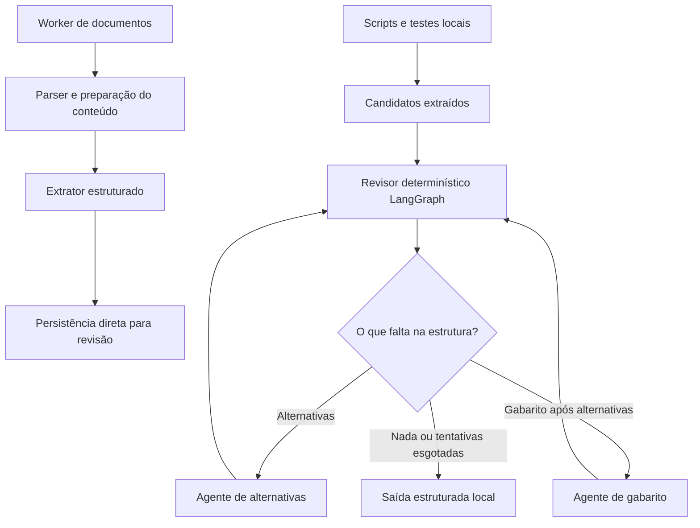
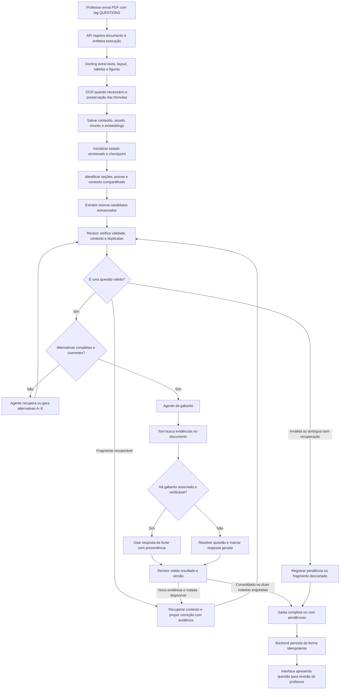

# Como funciona a extração agêntica de questões

Referência: 06/11/2026. Este guia separa o código atual do fluxo corrigido proposto. [Especificação e critérios de aceite](../../specs/2026-11-06-correcao-fluxo-agentico-questoes/spec.md).

## O que existe hoje

O processamento normal do worker chama a extração estruturada, que pode salvar candidatos diretamente. O grafo existe, mas sua execução foi exercitada por testes/scripts locais e não está conectado ao caminho normal do worker. O revisor do grafo é uma função de regras, não uma LLM revisora de conteúdo.

Atualmente o estado contém referências de contexto, candidatos, resultados, tentativas e alertas. Não contém automaticamente todo o PDF em texto. O provider carrega o conteúdo quando solicitado. No teste IFF, um provider local forneceu texto integral sem imagens; o provider Prisma carrega chunks da questão, alguns chunks com a palavra gabarito e figuras selecionadas. Esses caminhos não são equivalentes.

O revisor checa principalmente se há cinco rótulos e uma resposta compatível. Os agentes devolvem alterações, o revisor consolida e escolhe o próximo nó. Ainda faltam validação de identidade, evidência comprovada, retomada durável e integração com persistência no fluxo normal.

## Fluxo corrigido proposto

### 1. Entrada e preparação do documento

A API registra o upload e o worker assume o trabalho. Docling preserva texto, ordem de leitura, páginas, tabelas e figuras. OCR recupera conteúdo escaneado quando necessário; fórmulas exigem atenção a índices, expoentes e disposição espacial. O texto bruto e as evidências visuais devem permanecer disponíveis, mesmo que a LLM apresente uma interpretação incompleta.

### 2. Chunks, embeddings e imagens

Chunks e embeddings são salvos para busca. O modelo recebe texto legível e imagens, não vetores numéricos. Assets mantêm página, região e vínculos. Figuras integrantes da questão devem aparecer junto ao enunciado ou alternativa correspondente; não adicionar imagem à questão sem evidência de que faz parte dela.

### 3. Estado compartilhado e segmentação

O estado guarda referências duráveis, versões e decisões. Os agentes consultam o mesmo documento versionado sem copiar PDFs/base64 para cada checkpoint. A segmentação identifica provas ou listas diferentes, inclusive quando a numeração reinicia. Cabeçalhos, títulos, páginas e contexto sustentam a associação; instituição e ano desconhecidos não são inventados.

Documento pequeno pode ser extraído em um corpo textual único. Documento longo exige lotes que preservem fronteiras e cobertura; o gabarito pode estar fora do lote e continua pesquisável globalmente.

### 4. Agente extrator

Transforma o conteúdo em candidatos com enunciado, alternativas recuperáveis, número, fontes e vínculos visuais. Preserva afirmações e tópicos no enunciado. Não completa lacunas com invenções nesta etapa e não salva diretamente em Question. Um candidato ainda não é uma questão pronta.

### 5. Revisor e recuperação de contexto

Decide se o candidato realmente é uma questão; identifica fragmentos, duplicidade, alternativas faltantes, evidência insuficiente e problemas visuais. Regras determinísticas conferem contrato e identidade; análise contextual ajuda nas ambiguidades. Uma URL solta não recebe cinco alternativas. Conteúdo ausente é procurado antes de gerar conteúdo novo.

Se recuperar afirmações que ficaram nas opções, devolve um patch de enunciado com evidência e mantém o snapshot original. Se não conseguir, conserva a pendência em vez de esconder a perda.

### 6. Agente de alternativas

Recebe questão válida e seu contexto. Recupera opções da fonte, corrige associações sustentadas por evidência e gera apenas o necessário. Discursivas recebem cinco opções coerentes. Sempre trabalha com A–E e informa o que foi recuperado, corrigido ou gerado. Alterar rótulos/textos invalida o gabarito que dependia da versão antiga.

### 7. Agente de gabarito e sua ferramenta

Recebe identidade da questão/caderno e as cinco alternativas finais. A ferramenta busca texto, tabelas e imagens de gabarito em todo o documento. O agente associa a evidência à prova e ao número correto; a validação não se limita a confiar em foundInSource.

Se houver mais de um gabarito, compara as identidades e registra conflitos. Se não encontrar associação segura, resolve a questão e marca AI_GENERATED. A obrigação de propor uma letra não autoriza dizer que ela foi encontrada no documento. Respostas incertas permanecem para revisão com alertas.

### 8. Retorno ao revisor

Os agentes devolvem resultados por candidateId e versão. O revisor reavalia pendências, rejeita respostas obsoletas e consolida. Para uma mesma questão, alternativas precedem o gabarito. Questões independentes podem ser processadas simultaneamente com concorrência controlada. Isso evita que um gabarito seja calculado sobre opções que outro agente ainda está alterando.

### 9. Persistência e interface

O backend usa o contrato atual e salva idempotentemente. Todas as questões seguem PENDING_REVIEW. A interface apresenta texto, fórmulas e figuras com suas posições, além dos campos de revisão já suportados. Um status interno de execução concluída não significa aprovação de conteúdo. Candidatos parciais e fragmentos permanecem rastreáveis sem virar questões falsamente completas.

### 10. Retomada e observabilidade

Checkpoints permitem retomar após interrupção; chaves estáveis evitam duplicação. O histórico preserva entradas/saídas, evidências, origem e versão, sem segredos. Tempo, tokens e chamadas são medidos por etapa. Tentativas de correção são limitadas para evitar loops; não se interrompe a inferência apenas porque demorou mais que uma expectativa arbitrária.

## Exemplo genérico

Um PDF contém Prova Azul e Prova Verde, ambas com questão 1. O extrator mantém dois candidatos de segmentos distintos. A ferramenta encontra duas tabelas; a associação usa a versão da prova e suas evidências. A questão 1 Azul não usa a letra da Verde apenas porque tem o mesmo número. Se a versão da tabela estiver ilegível, o agente pode propor uma solução, mas registra origem IA e o conflito de associação.

## O que os testes precisam demonstrar

[Plano de testes](../../specs/2026-11-06-correcao-fluxo-agentico-questoes/test-plan.md): contrato e roteamento, origem comprovada, ausência de hardcoding, recuperação de fórmulas/figuras, retomada, persistência e revisão visual. Teste mockado demonstra regras de controle; teste real demonstra comportamento observado do modelo; upload até interface demonstra integração. Nenhum substitui os outros.
