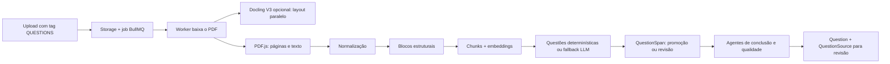

# Processamento de questões extraídas de PDF

**Estado descrito em 27/10/2026.** Esta página é o ponto de entrada para entender o fluxo que o código executa hoje. As specs e os planos ligados no fim registram propostas, testes e decisões de outras datas; consulte o estado indicado em cada um antes de tratar um item como implementado.

## Visão do fluxo atual

1. O upload envia PDF, matéria, tópico e tag. O arquivo é guardado em `monitor-documents`, um `MonitorDocument` é criado e um job é enfileirado. O tópico informado é a fonte de escopo da questão. Ver [categorização](./categorizacao-documentos.md) e [repositório de documentos](../../backend/src/repositories/document.repository.ts).
2. O [worker](../../backend/src/worker/services/document-worker.service.ts) baixa o PDF. `DOCUMENT_TEXT_SOURCE=docling|auto` aciona `/chunk` **somente para `KNOWLEDGE_BASE`**. Para `QUESTIONS`, o texto efetivo da extração continua vindo do PDF.js. Com `DOCUMENT_TEXT_SOURCE=pdfjs` e V3 habilitado, o Docling pode produzir layout em paralelo; esse layout não substitui as páginas usadas na extração de questões.
3. O worker extrai páginas com layout PDF.js, normaliza o texto e mede qualidade. Se o documento precisar de OCR, marca `NEEDS_OCR` e pula blocos, chunks e questões. Ligar OCR no serviço Python, isoladamente, não faz o fluxo de `QUESTIONS` consumir o texto OCR. Veja a [spec de qualidade](./specs/2026-10-26-document-parser-quality-design.md).
4. A [detecção de blocos](../../backend/src/worker/services/document-block-detection.service.ts) tenta reconstruir `QUESTION` e outros blocos. O [chunker](../../backend/src/worker/services/chunk.service.ts) cria chunks, e o worker tenta embeddings. Falha de embedding é registrada como operação não bloqueante, mas a extração de questões exige chunks em estado `READY`.
5. A [extração de questões](../../backend/src/worker/services/question-extraction.service.ts) exige chunks `READY` e tópicos vinculados. Se houver blocos `QUESTION`, extrai candidatas deterministicamente desses blocos; blocos elegíveis restantes podem seguir pelo fallback LLM. Sem blocos explícitos, o fallback considera apenas blocos que parecem exercícios. O fallback agrupa chunks e tem limites de contexto: ainda é um ponto de risco para cortes em documentos maiores.
6. Cada candidata gera um `QuestionSpan` com origem, páginas/chunks e decisão de promoção. Enunciado inconsistente, estrutura inválida ou figura necessária ausente mantém a candidata em `BLOCKED`, `REVIEW_REQUIRED` ou `VISUAL_PENDING`, sem conclusão automática. Candidatas promovidas passam pelos agentes de reconstrução, alternativas, resposta, explicação, categoria, normalização e revisão de qualidade conforme os campos faltantes.
7. A questão salva fica para revisão (`needsReview=true`) e carrega proveniência em `QuestionSource`, origem dos campos, qualidade, faltantes e falhas de agentes em metadados. Uma falha dos agentes pode resultar em questão parcial para revisão. Falha da operação de extração é não bloqueante para o documento e pode terminar em `PARTIAL_SUCCESS`; isso não prova que todas as questões do PDF foram salvas.

## Onde o fluxo pode perder questões

| Etapa | Sinal | Consequência |
| --- | --- | --- |
| PDF/OCR | `NEEDS_OCR`, página com texto insuficiente | Nenhum bloco ou questão dessa tentativa. |
| Blocos | Marcador de questão não reconhecido ou fronteira errada | Questões somem, juntam-se ou são cortadas antes do LLM. |
| Chunks | Fragmentação ou falta de chunk `READY` | Candidata sem fonte completa ou extração ignorada. |
| Promoção | `VISUAL_PENDING`, `REVIEW_REQUIRED`, `BLOCKED` | Candidata retida como span; não vira questão concluída automaticamente. |
| Agentes | timeout, `INVALID_SCHEMA`, saída truncada | Questão parcial, retry ou falha registrada. |
| Persistência | duplicata, origem/tópico inválido ou erro de banco | Contagem de candidatas difere da contagem de questões salvas. |

A observabilidade precisa fechar a conta entre blocos detectados, candidatas, promovidas, retidas e salvas. O documento [Qualidade do parser](./specs/2026-10-26-document-parser-quality-design.md) contém a métrica e os casos que motivaram essa exigência.

## Evidência medida com PDFs do repositório

- [Corpus e comandos de teste](../../tests/document-parser/README.md): `questionsQuimica.pdf` tem dez questões. No teste local, após correções de fronteira, o PDF.js produziu dez blocos, dez chunks e dez candidatas determinísticas. Nove foram classificadas como prontas para conclusão; a questão 01 ficou `VISUAL_PENDING` por depender da tabela periódica na página 15. O teste para antes de IA e banco, portanto **não comprova dez questões persistidas**.
- O mesmo corpus processado por `/v1/parse` do Docling concluiu a conversão, mas o montador de blocos não reconheceu os marcadores `QUESTÃO 08` sem pontuação e produziu zero blocos de questão naquele experimento. Isso é distinto do caminho produtivo PDF.js.
- `ocrTeste.pdf` mede uma base de conhecimento escaneada; não demonstra OCR funcional na extração de `QUESTIONS`.

## Relação com as imagens e com o chat

O checkout local já contém relações para vincular figuras a chunks/questões, armazenamento privado, upload de imagem no chat e gateway multimodal. As flags permanecem desligadas por padrão. O reteste do parser v2 agora exporta a tabela da questão 01, mas ainda não mede o vínculo, a entrega da imagem ao chat nem a resposta da IA; portanto, ainda não há evidência de rollout funcional em produção. Veja o [relatório piloto de avaliação visual](../../tests/document-parser/visual-quality/README.md) e a [spec de imagens e chat](./specs/2026-10-27-chat-multimodal-document-images-design.md).

## Documentos sobre questões

| Documento | O que contém |
| --- | --- |
| [Backlog e relatórios de questões](./questoes-backlog.md) | Pendências de `QuestionSpan`, matemática, visual, agentes e testes. |
| [Backlog anterior do backend](./questoes-backlog-backend.md) | Falhas estruturadas, tópicos e tarefas antigas. |
| [Qualidade do parser e questões, 26/10](./specs/2026-10-26-document-parser-quality-design.md) | Baseline dos PDFs reais, OCR, cortes e critérios de aceite. |
| [Spec de qualidade de questões](./specs/2026-08-26-document-question-pipeline-quality-design.md) e [variante backend](./specs/2026-08-26-document-question-pipeline-quality-design-backend.md) | Propostas anteriores de promoção, conclusão e revisão. |
| [Planos de qualidade de questões](./planos/2026-08-26-document-question-pipeline-quality.md) e [variante backend](./planos/2026-08-26-document-question-pipeline-quality-backend.md) | Sequências de implementação anteriores. |
| [Melhoria V3 visual](./planos/2026-09-08-melhoria-v3.md) | Proposta histórica de layout, tabelas, fórmulas e figuras. |
| [Spec multimodal](./specs/2026-10-27-chat-multimodal-document-images-design.md) | Contrato de associação questão–imagem e envio multimodal ao chat. |
| [Spec de avaliação visual](./specs/2026-10-27-avaliacao-qualidade-imagens-questoes-design.md) | Corpus, métricas e rubrica para saber se a IA compreendeu pergunta e imagem. |
| [Plano multimodal e avaliação](./planos/2026-10-27-imagens-pdf-chat-qualidade.md) | Tarefas, arquivos, verificações e relatório de qualidade da resposta. |
| [Processamento da base de conhecimento](./base-conhecimento.md) | Incidentes do parser e agentes que também afetam ingestão de questões. |
| [Corpus de PDFs e testes](../../tests/document-parser/README.md) | Amostras, comandos e resultados observados. |

Para documentos relacionados ao banco de questões que **não** dependem da extração de PDF, consulte [materialização do banco](../superpowers/specs/2026-10-20-question-bank-materialization-background-design.md) e [importação Gran](../superpowers/specs/2026-10-14-gran-question-bank-import-design.md).
