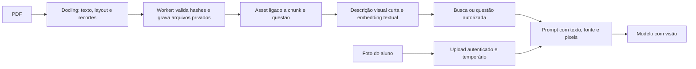

# Imagens em documentos de conhecimento e no chat

## Objetivo

Permitir que o chat do aluno responda usando imagens como contexto. As imagens podem vir de duas fontes: figuras, tabelas e fórmulas presentes nos PDFs da base de conhecimento; ou arquivos enviados pelo aluno junto com uma pergunta, inclusive uma foto da questão. A IA deve receber texto e imagens relevantes na mesma solicitação multimodal.

## Estado atual

- O endpoint principal do Docling (`/chunk`) produz chunks de texto, páginas e coordenadas de proveniência, mas não exporta os bytes das figuras.
- O banco já contém `DocumentVisualAsset` e `DocumentLayoutElement`, e há um caminho V3 de layout que pode representar assets. O fluxo principal de chunks não liga esses assets aos chunks que são usados no RAG.
- A busca do chat recupera até oito chunks de texto. As citações não incluem referências aos assets.
- As mensagens enviadas ao gateway OpenRouter são texto simples. O chat guarda histórico temporário no Redis, que hoje não guarda anexos de imagem.
- O endpoint de envio já valida autenticação e autorização do escopo aluno/monitor/matéria. Anexos precisam passar pelas mesmas verificações.
- A interface aceita selecionar `image/*`, mas guarda somente o nome em `attachedFile` e envia JSON sem bytes nem referência à imagem. Hoje o aluno vê um anexo que a IA não recebeu.
- `QuestionSource` liga questão a chunk/bloco, sem ligação com `DocumentVisualAsset`. A evidência oficial da questão também é apenas textual. Documentos `QUESTIONS` ainda podem usar PDF.js para texto.
- O histórico Redis guarda até 40 mensagens e expira após cinco horas de inatividade, com TTL renovado em cada mensagem.

## Desenho

### 1. Imagens vindas dos PDFs

1. Durante a conversão, o parser exporta figuras, tabelas e fórmulas úteis como arquivos de imagem. Para a primeira versão, cada asset deve ter página, caixa delimitadora quando disponível, tipo, dimensões, MIME type, hash e referência ao elemento do layout.
2. O worker persiste os bytes em armazenamento privado e os metadados em `DocumentVisualAsset`. A resposta do parser não deve carregar todas as imagens em base64 junto com os chunks de texto.
3. O worker relaciona os assets aos chunks pela proveniência do chunk: mesmo elemento de origem ou interseção de página e região. Quando não houver coordenadas confiáveis, a página gera apenas um candidato de baixa confiança para revisão; não publica vínculo automático.
4. No RAG, cada citação pode trazer IDs de assets relacionados. A recuperação não torna o arquivo público: o backend lê o asset autorizado e prepara o conteúdo para a chamada ao modelo.
5. A extração visual também roda para documentos `QUESTIONS`, independentemente de o texto das questões ter vindo de PDF.js ou Docling. Uma imagem do enunciado precisa ser ligada à questão correta, inclusive quando duas questões compartilham a página.

### 2. Imagem enviada pelo aluno

1. O aluno pode anexar uma imagem ao compor a mensagem. A interface mostra uma prévia e permite removê-la antes do envio.
2. A API autenticada aceita texto e um conjunto pequeno de imagens nos formatos JPEG, PNG ou WebP, com limite de tamanho e quantidade. Ela valida o tipo real do arquivo, não apenas a extensão, e aplica limites de resolução para evitar payloads excessivos.
3. A imagem é armazenada em caminho privado temporário, com escopo do aluno/conversa e retenção compatível com o histórico temporário do chat. O histórico guarda apenas metadados e referência segura, nunca URL pública.
4. No envio da mensagem, a imagem fica associada à pergunta atual. Se a pergunta estiver vinculada a uma questão, o contexto autorizado da questão e a imagem são enviados juntos. O modelo pode ler diagramas, gráficos, tabelas, fórmulas e texto visível na foto.
5. Em turnos posteriores, uma imagem anterior só será reutilizada se ela fizer parte do histórico selecionado para aquela conversa e ainda estiver dentro da retenção. O prompt deve identificar claramente qual imagem pertence a qual mensagem.

### 3. Chamada multimodal ao modelo

- O contrato de mensagem do chat passa a aceitar partes de texto e imagem, mantendo mensagens apenas textuais válidas.
- O gateway constrói o payload multimodal aceito pelo endpoint de chat completions do OpenRouter. Imagens privadas são lidas pelo servidor e enviadas como conteúdo de imagem; o modelo não recebe credenciais nem URLs públicas do Supabase.
- O modelo configurado para chat precisa aceitar imagens. Se o modelo escolhido não suportar visão ou o provedor rejeitar a imagem, o sistema registra a falha com código claro e informa o aluno sem fingir que analisou a imagem.
- O prompt instrui a IA a descrever somente o que consegue observar, indicar quando a imagem estiver ilegível e combinar a imagem com o texto da questão sem inventar elementos ausentes.

### 4. Seleção de imagens da base

- Em dúvida sobre uma questão autorizada, selecionar primeiro as imagens ligadas diretamente àquela questão; em perguntas gerais, selecionar as imagens ligadas aos chunks recuperados. Nunca enviar todos os assets do PDF.
- A primeira versão envia um número limitado de imagens por chamada. Prioriza vínculos por elemento e região; um recorte ampliado ou página delimitada atende casos em que o crop perdeu contexto.
- A citação mantém página e documento. Isso permite explicar de qual fonte veio a figura e depurar seleções incorretas.

## Fluxo detalhado do PDF até a resposta



### Contrato do parser e transporte

- Configurar Docling para reter imagens de figuras e tabelas e, quando necessário, imagens de página para realizar os recortes. Usar `PictureItem`/`TableItem.get_image(document)` com proveniência. Fórmulas já legíveis em texto continuam como texto; fórmulas desenhadas entram como recorte visual. Incluir pequena margem para não cortar eixos, rótulos e legendas, sem misturar a questão vizinha.
- Introduzir `doc-chunker/v2` com um **pacote binário** contendo `manifest.json` e arquivos `assets/<assetKey>.<ext>`. O v1 continua disponível. O serviço Python não precisa de credenciais do Storage nem de cache compartilhado entre réplicas; metadados e bytes vêm da mesma conversão. O worker valida o hash do PDF, versão, nomes dos arquivos, MIME real, hashes dos assets, quantidade e tamanho expandido do pacote.
- Cada asset no manifesto inclui `assetKey` estável, `sourceItemRef`, página, bbox, origem das coordenadas, tipo, MIME, dimensões, SHA-256, legenda, refs de elementos vizinhos e estado do crop. Cada chunk mantém suas refs de origem e as `assetKeys` relacionadas.
- Limites de contagem/bytes e qualquer falha de crop geram warning por asset e métrica de cobertura; nunca declarar processamento visual completo quando houve omissão. Referência explícita a figura sem imagem utilizável marca a questão para revisão visual.

Exemplo resumido de `manifest.json` no pacote:

```json
{
  "schema_version": "doc-chunker/v2",
  "doc_hash": "sha256-do-pdf",
  "chunks": [{ "index": 0, "text": "...", "pages": [15], "asset_keys": ["visual-1"] }],
  "assets": [{
    "asset_key": "visual-1",
    "source_item_ref": "/pictures/0",
    "page": 15,
    "bbox": [10, 20, 200, 300],
    "coord_origin": "BOTTOMLEFT",
    "type": "FIGURE",
    "file": "assets/visual-1.png",
    "sha256": "sha256-do-recorte",
    "caption": "Tabela periódica"
  }],
  "warnings": []
}
```

### Como armazenar os recortes

Usar o bucket **privado** existente `document-parser-artifacts`. O PDF original permanece em `monitor-documents`. Os bytes da imagem ficam apenas no Storage, no caminho determinístico:

```text
document-parser-artifacts/{documentId}/{parseRunId}/visuals/{assetKey}-{sha256prefix}.png
```

O worker cria ou reutiliza um `DocumentParseRun` para a conversão Docling principal. `DocumentVisualAsset` guarda página, bbox, tipo, dimensões, checksum, `storagePath`, estado e versão da descrição. Acrescentar `sourceKey` único no parse run para retries idempotentes. O worker faz upload, valida a existência do objeto e grava as linhas/vínculos; falhas intermediárias deixam o run incompleto e uma rotina remove objetos órfãos. Reprocessar gera novo parse run; o anterior só é retirado depois de os novos vínculos estarem prontos. Excluir linhas do banco exige remover também objetos do Storage.

Criar duas relações com chaves estrangeiras, sem depender de arrays JSON:

| Relação | Dados necessários |
| --- | --- |
| `DocumentChunkVisualAsset` | `chunkId`, `assetId`, papel (`INLINE`, `CAPTION`, `NEARBY`), método e confiança do vínculo. |
| `QuestionVisualAsset` | `questionId`, `assetId`, papel (`STATEMENT`, `ALTERNATIVE`, `EXPLANATION`, `CONTEXT`), método e confiança. |
| `QuestionSpanVisualAsset` | `questionSpanId`, `assetId`, papel, método e confiança; mantém candidatos ambíguos disponíveis para revisão sem torná-los contexto autorizado do chat. |

Primeiro associar por `self_ref`/elemento estrutural; depois usar bbox, ordem de leitura, legenda e intervalo espacial da questão. A simples coincidência de página é fraca: se há duas questões ou figuras na mesma página, não escolher uma por proximidade textual sem evidência suficiente. Em caso ambíguo, manter o asset, registrar `VISUAL_LINK_AMBIGUOUS` e pedir revisão em vez de alimentar o chat com a figura errada. Questões que atravessam páginas consideram todo o intervalo de origem.

### Como a imagem se torna encontrável e compreensível

Depois de gravar o arquivo, o worker pede a um modelo com visão uma **descrição factual curta**: tipo de gráfico, títulos, eixos, rótulos, texto/números legíveis, relações visíveis e incertezas. A instrução não pede solução, gabarito ou inferências além dos pixels. Guardar descrição, modelo, versão e estado (`READY`, `FAILED`, `REVIEW_REQUIRED`) ligados ao asset.

Combinar descrição, legenda, títulos próximos e página em um chunk visual próprio, embeddado pelo modelo Qwen já usado para texto. Isso permite achar um gráfico pela pergunta “qual gráfico mostra o pH?” mesmo que a figura não tenha texto extraível. Ao responder, a IA recebe **a imagem original além dessa descrição**: a descrição facilita a busca, mas não substitui os pixels nem é tratada como prova infalível. Falha na descrição entra em retry observável e deixa a cobertura visual incompleta.

### Como garantir o contexto de uma questão

1. O endpoint de chat já autoriza a questão, monitor e matéria. Após essa autorização, carregar os `QuestionVisualAsset` do enunciado e das alternativas **antes** da busca semântica. A figura da questão entra no prompt mesmo que outro chunk tenha score maior.
2. As evidências oficiais e o RAG podem acrescentar figuras explicativas de conhecimento. O prompt identifica a origem de cada imagem: `Q1: figura da questão 05, documento X, página 15`; `K1: figura de apoio, documento Y, página 4`; `U1: foto enviada pelo aluno agora`.
3. Quando um crop omite rótulos ou legenda, usar um crop ampliado da região; se necessário, renderizar a página e delimitar no prompt a região da questão. Página inteira não é enviada em toda chamada e não serve para atribuir uma figura ambígua a uma questão por adivinhação.
4. O orçamento multimodal prioriza imagem atual do aluno, imagem da questão e depois imagens de conhecimento. Limitar quantidade, pixels e bytes separadamente dos 12.000 caracteres atuais do contexto textual. Não deixar um `slice` de texto apagar a identificação de uma imagem enviada.
5. Se a imagem necessária estiver ausente, ilegível ou associada com baixa confiança, a resposta informa a limitação e pede uma foto/recorte melhor ou encaminha para revisão. Nenhum fallback textual pode afirmar que a IA viu uma imagem que não recebeu.
6. Em perguntas de acompanhamento como “e nessa figura?” ou “por que a alternativa C?”, resolver o `questionId` do anexo explícito ou do histórico recente e **recarregar do banco** enunciado, alternativas, fontes e imagens autorizadas. O `ChatContextResolver` atual recupera o ID da questão, mas `ChatService` ainda envia `questionContext: null` ao gerador quando o aluno não repete o anexo; a implementação precisa corrigir essa perda. Se houver uma nova questão anexada, a anterior não pode contaminar o prompt.
7. Cada solicitação ao modelo leva um manifesto interno do contexto efetivo: `questionId`, IDs dos chunks, IDs dos assets, origem (`QUESTION`, `KNOWLEDGE`, `STUDENT`), página, método de associação e hash dos bytes enviados. O manifesto serve para auditoria e avaliação; não contém imagem, URL assinada nem enunciado integral.

Essas regras garantem **rastreabilidade e detecção de perda de contexto**, não acerto absoluto de interpretação visual. A qualidade real precisa ser medida com casos conhecidos do corpus.

### Upload real no chat

- Trocar `attachedFile: string` por `File` e prévia. O seletor atual apenas guarda o nome; após esta mudança, os bytes devem chegar à API. Mostrar miniatura, tamanho, estado de envio, remoção e erro claro.
- Criar endpoint autenticado multipart no escopo aluno/monitor/matéria. Limites iniciais propostos: **1 imagem por mensagem, 5 MiB, JPEG/PNG/WebP e no máximo 4096 × 4096 pixels antes da normalização**. Conferir assinatura, MIME, decodificação e dimensões. Rejeitar SVG, HEIC e arquivo corrompido.
- Salvar em novo bucket privado `chat-attachments`. Criar `ChatImageAttachment` com ID opaco, dono, monitor, matéria, path, MIME, bytes, dimensões, hash e `expiresAt`. O endpoint retorna o ID, nunca uma URL pública.
- O POST JSON existente de mensagens recebe `imageAttachmentIds` e verifica novamente dono, escopo, expiração e existência do objeto. Retry da mensagem reutiliza o ID sem reupload. Referências a path ou URL fornecidas pelo cliente são recusadas.
- Redis guarda somente IDs/rótulos dos anexos. Uma rota autenticada fornece a prévia no histórico. TTL da conversa segue em cinco horas de inatividade; o objeto expira no máximo em 24 horas. Após expirar, o histórico pode mostrar “imagem expirada” e não a reenviar à IA.
- Limpar anexos quando a conversa é encerrada e por rotina de `expiresAt`, cobrindo upload abandonado, mensagem removida do histórico e falhas de rede. Não confiar apenas no TTL do Redis para apagar arquivos.

### Envio multimodal e modelo

`ChatPromptMessage.content` e `OpenRouterClient.createChatCompletion` passam a aceitar string ou partes de texto e imagem. Para mensagem com imagem, o backend lê os bytes privados e monta uma lista com texto identificado e partes `image_url` como data URI. Mensagens textuais antigas mantêm o formato string. O modelo recebe pixels sem credenciais do Supabase.

Antes de ativar, conferir que `CHAT_AI_MODEL` aceita `image` como modalidade de entrada e medir leitura de gráficos, fórmulas e fotos reais. Modelo incompatível, falha de download ou rejeição do provedor retornam erro explícito. Conteúdo visual, inclusive texto dentro da imagem, é dado não confiável e não pode alterar as instruções do assistente.

## Segurança e retenção

- Buckets e objetos permanecem privados. A autorização do chat continua sendo verificada antes da leitura de imagens.
- Validar MIME real, extensão, tamanho, dimensões e quantidade; rejeitar formatos não suportados e arquivos corrompidos.
- Limitar bytes e quantidade total de imagens enviadas ao modelo. Registrar IDs, tamanhos, páginas, duração e resultado, sem registrar bytes, URLs assinadas ou conteúdo visual em logs.
- Imagens enviadas pelo aluno expiram em até 24 horas, inclusive se o histórico Redis ainda existir; objetos expirados são removidos por rotina própria. Assets de PDFs seguem a retenção do documento pai e são removidos quando o documento é excluído.
- A UI não deve exibir URL de armazenamento persistente. Para exibir imagens de documentos, a API pode emitir URLs assinadas curtas após autorização.

## Mudanças esperadas

- **Parser Python:** configurar exportação de imagem Docling e produzir pacote v2 com manifesto e bytes separados.
- **Worker Node:** validar pacote, gravar assets privados, descrever/indexar imagens e persistir vínculos com chunks e questões.
- **Banco:** estender `DocumentVisualAsset` e criar relações explícitas chunk–asset, questão–asset e o registro temporário de anexos do chat.
- **API de chat:** aceitar upload autenticado multipart e ID seguro no envio JSON da mensagem; retornar erros de validação específicos.
- **Histórico Redis:** serializar metadados de anexos e referências temporárias respeitando TTL.
- **Frontend do aluno:** seletor de imagem, prévia, remoção, estado de envio e apresentação da imagem anexada no histórico.
- **Gateway OpenRouter:** aceitar conteúdo multimodal e validar suporte do modelo configurado.
- **Observabilidade:** eventos para upload recebido/validado, asset persistido, imagem selecionada, chamada multimodal iniciada/concluída/falha, com contagens e tamanhos, sem conteúdo sensível.

## Critérios de aceite

1. PDF digital e escaneado com gráfico/figura produzem recorte legível, hash, página e proveniência; um PDF sem figuras segue indexado.
2. Um chunk recuperado seleciona somente assets ligados ao trecho correspondente. O chunk visual é encontrável por descrição, legenda e título, e a IA recebe os pixels.
3. Na questão com tabela periódica em `questionsQuimica.pdf`, a figura pertence à questão correta e chega à IA ao usar “Tirar dúvida com IA”; não é atribuída à questão adjacente.
4. Em `ocrTeste.pdf`, OCR e chunks continuam funcionando e a cobertura visual é registrada sem criar imagens fictícias.
5. Uma mensagem do aluno com foto transmite bytes reais, preserva a prévia autorizada no histórico e chega ao modelo junto com a pergunta e a questão autorizada. Retry não duplica anexo.
6. A resposta interpreta elementos visuais verificáveis, cita documento e página quando usa PDF e admite imagem ilegível ou ausente. Vínculos ambíguos ficam sinalizados.
7. Mensagens antigas sem imagem e chamadas só com texto continuam compatíveis.
8. Referência forjada de outro aluno/monitor/matéria, formato falso, arquivo corrompido, limites excedidos, objeto ausente e modelo sem visão têm erros explícitos.
9. Objetos de upload expirados ou de conversa encerrada são removidos; assets do documento saem quando o documento é excluído. O banco não deve manter vínculo válido com objeto inexistente.
10. Uma pergunta de acompanhamento herda a **questão autorizada e a imagem correta**, não só o ID no histórico. Uma nova questão anexada substitui o contexto anterior; imagem antiga expirada não é enviada.

## Avaliação posterior da qualidade

A avaliação ponta a ponta está na [spec separada de avaliação da qualidade](./2026-10-27-avaliacao-qualidade-imagens-questoes-design.md) e será executada após a implementação do fluxo visual. Os testes unitários e de contrato de cada componente continuam junto da implementação.

## Decisões operacionais a verificar durante a implementação

- Confirmar a modalidade `image` do modelo configurado, a forma exata de envio de data URI e o limite de imagens/payload do provedor; ajustar o orçamento visual antes de produção.
- Validar o comportamento de `get_image(document)` na versão fixada do Docling com PDFs digitais e escaneados, incluindo tabelas e imagens que dependem de renderização da página.
- Definir frequência e paginação da rotina de limpeza dos dois buckets e medir objetos órfãos.
- Medir taxa de associação correta com amostras de páginas contendo várias questões/figuras; o limiar de confiança é configurável e nunca converte ambiguidade em vínculo certo.

## Fora do escopo inicial

- Indexar imagens por embeddings visuais ou busca por semelhança de imagem.
- OCR adicional independente do OCR do Docling.
- Enviar páginas inteiras automaticamente em toda resposta.
- Tornar assets de documentos públicos ou persistir imagens do aluno como parte permanente da base de conhecimento.

## Sequência proposta

1. Contrato v2 do parser, extração de recortes, persistência privada e vínculos com chunks/questões.
2. Descrição factual, indexação textual dos assets e medição de cobertura/ambiguidade.
3. Seleção visual no RAG, priorização da questão autorizada e envio multimodal ao OpenRouter.
4. Upload real no chat, prévia, histórico, validação e limpeza temporária.
5. Avaliação nos PDFs de questões e conhecimento, ativação por configuração e observação em produção.

O detalhamento executável está no [plano de imagens de PDFs, chat e avaliação](../planos/2026-10-27-imagens-pdf-chat-qualidade.md).

## Referências técnicas verificadas

- [Docling: exportação de figuras e tabelas](https://docling-project.github.io/docling/_generated/examples/export_figures/) e [opções do pipeline](https://docling-project.github.io/docling/reference/pipeline_options/): geração de imagens e `get_image`.
- [OpenRouter: entrada de imagem em chat completions](https://openrouter.ai/blog/tutorials/send-image-to-llm/): texto e `image_url`, com exigência de modelo que suporte imagem.
- [Supabase: buckets privados e URLs assinadas](https://supabase.com/docs/guides/storage/serving/downloads): arquivos privados exigem autorização ou URL temporária.
