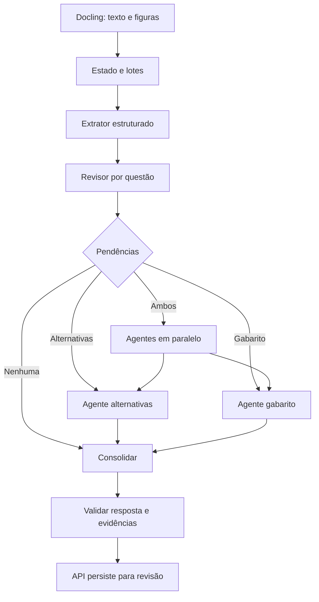

# Extração e revisão de questões com LangGraph

**Estado:** proposta para implementação; nenhuma alteração de produção está implícita.  
**Contexto:** [processamento de questões](../../docs/processamentopdf/questoes.md) e [completude visual e fórmulas](../../docs/superpowers/specs/2026-11-06-question-formula-visual-completeness-design.md).

## Objetivo

Transformar documentos QUESTIONS em questões para revisão do professor, coordenando extração, identificação de lacunas, complementação de alternativas e gabarito por LangGraph. A resposta final ideal tem enunciado, cinco alternativas A–E e uma resposta correspondente. O conteúdo extraído e suas figuras continuam disponíveis como contexto para todos os agentes que precisarem deles.

## Escopo e limites

- O Docling, OCR quando necessário, chunks, embeddings e assets visuais existentes continuam anteriores ao grafo. O PDF original não é enviado aos modelos.
- O estado armazena referências duráveis ao texto integral, chunks, páginas, evidências de fórmulas e assets. Cada nó pode carregar o contexto pertinente; busca de gabarito deve alcançar todo o documento, inclusive imagens. Não presumir que um chunk ou busca vetorial isolada cobre o documento inteiro.
- O extrator produz resposta estruturada sem inventar conteúdo; o revisor decide quais agentes acionar. Questões discursivas são convertidas em múltipla escolha: preservar o enunciado e gerar cinco alternativas e gabarito.
- Preservar alternativas existentes; recuperar do documento as faltantes e gerar as demais. Se uma parecer errada, conferir contexto e imagens, preservar o original no histórico quando houver correção. Não trocar conteúdo apenas porque o modelo discorda sem evidência.
- O agente de gabarito procura no documento, inclusive imagens pertinentes; se não houver gabarito/contexto conclusivo, resolve a questão pelas alternativas e não retorna resposta vazia. Respostas geradas são propostas sujeitas à revisão humana.
- Se ambos os agentes forem necessários, executá-los em paralelo com snapshots imutáveis. O gabarito pode inicialmente ser uma resposta textual; após a junção, associá-lo às cinco alternativas finais ou executar uma chamada de reconciliação. Nunca assumir que uma letra gerada antes das alternativas corresponde à letra final.
- Configurar todos os nós de IA para `deepseek/deepseek-v4.1-flash` pela configuração específica do fluxo, sem alterar a configuração global de outras chamadas. Verificar suporte a imagem e saída estruturada no provider efetivamente selecionado; falha explícita se indisponível.
- O grafo devolve candidatos estruturados ao serviço de aplicação do backend; a persistência usa o repositório/API existente. Hoje o extrator chama `saveQuestion` diretamente: separar extração e gravação é parte do trabalho. Não criar novo endpoint público sem necessidade.
- Manter o schema Prisma de `Question` e o formato `alternatives: [{label,text}]`. `alternativesOrigin` é geral: `AI_GENERATED` se qualquer alternativa foi gerada; `SOURCE_DOCUMENT` se todas forem da fonte. Registrar gabarito em `correctAnswerOrigin` e conteúdo gerado em `COMPLETE_WITH_AI` quando adequado. Rastreabilidade detalhada pode usar `QuestionAiGeneration` existente, sem exigir contrato por alternativa.
- Questões entregues para revisão são `PENDING_REVIEW` e `needsReview=true`. Se faltar evidência essencial, não inventar: retornar candidato parcial com pendências e preservar enunciado/figuras, sem sinalizar como completo.
- Nenhuma alteração na tag KNOWLEDGE_BASE; nenhuma chamada externa, migração ou deploy de produção faz parte desta especificação.

## Fluxo

## Estado e recuperação

Estado versionado por execução e por lote: `executionId`, `documentId`, `documentVersion`/hash, modelo e versão do prompt; referências aos chunks, páginas, fórmulas e imagens; candidatos com identidade estável, resultados de cada nó, pendências, tentativas e erros. O checkpoint durável do LangGraph guarda referências, não PDFs nem base64 de imagens; conteúdo é obtido do Storage/banco apenas quando necessário. Escolher e versionar implementação de checkpoint Postgres compatível com a versão instalada de LangGraph JS antes de implementá-la.

Para documentos longos, dividir por orçamento de tokens de entrada **e saída**, com sobreposição e fronteiras de questão quando reconhecíveis. Registrar intervalo, cobertura e identidade dos lotes; unir duplicatas por evidências de número, página e conteúdo, sem mesclar questões ambíguas automaticamente. O progresso diferencia lote pendente, em execução, concluído, falho e esgotado; documento fica parcial se houver lacunas. Retomar checkpoint após interrupção; repetir apenas o nó/lote falho, limitando tentativas e concorrência. O salvamento é idempotente por identidade estável de documento/questão e protege questões já revisadas; chamadas externas podem ocorrer mais de uma vez, mas não podem duplicar registros nem sobrescrever revisão humana.

## Critérios de aceite

- **AC-001:** PDFs QUESTIONS chegam ao grafo com acesso ao texto completo, fórmulas e figuras por referência; imagens pertinentes são enviadas ao modelo, sem PDF.
- **AC-002:** extrator preserva enunciados, alternativas, figuras e suas âncoras; retorna candidatos sem gravar diretamente.
- **AC-003:** revisor seleciona agentes por questão; quando ambos faltam, os dois são executados em paralelo e seus resultados são combinados sem conflito.
- **AC-004:** toda questão múltipla escolha entregue pelo grafo contém exatamente cinco alternativas A–E. Recuperar e preservar as opções identificáveis na fonte; completar faltantes e corrigir listas excedentes sem confundir afirmações I/II/III, tópicos ou itens de verdadeiro/falso do enunciado com alternativas. Para discursivas, gerar cinco opções. Identificar origem geral como IA quando aplicável.
- **AC-005:** procurar gabarito em todo o documento, inclusive imagens; quando ausente, propor resposta e registrar origem correta.
- **AC-006:** validar exatamente cinco alternativas, rótulos A–E únicos, textos não vazios, enunciado e gabarito compatível com alternativa final; caso contrário manter parcial com pendências, sem inventar.
- **AC-007:** API/backend persiste pelo contrato atual e mantém `PENDING_REVIEW`, `needsReview`, vínculos visuais e origens; não altera schema Question nem formato do JSON de alternativas.
- **AC-008:** progresso e checkpoints sobrevivem a falha/reinício; repetição não duplica questões nem altera revisão humana; lotes falhos não apagam resultados concluídos.
- **AC-009:** documento longo tem lotes com orçamento e sobreposição, cobertura auditável e deduplicação conservadora; busca de gabarito alcança outras páginas.
- **AC-010:** modelo configurado para todos os nós é DeepSeek específico; chamadas multimodais usam imagens e saída estruturada; erros são observáveis sem expor segredos.
- **AC-011:** regressões garantem fórmulas, figura e posição no corpus real, inclusive Quimica-3, preservando pendências e limites observados.
- **AC-012:** chamadas dos agentes de alternativas e gabarito não recebem teto local de tokens de saída nem timer local; falhas de JSON/schema acionam uma nova chamada corretiva, sem alterar limites de outras chamadas OpenRouter.
- **AC-013:** o gabarito sempre contém uma letra A–E quando existem cinco alternativas válidas. Sem evidência suficiente, o modelo resolve a questão e a resposta continua marcada para revisão se a confiança for baixa; o revisor só consolida saída estruturada validada.
- **AC-014:** o extrator estruturado limita opções a A–E e mantém afirmações numeradas/itens de verdadeiro ou falso no enunciado. Saídas com opções faltantes, repetidas ou excedentes são detectadas e encaminhadas ao agente de alternativas; o grafo não marca como `ready` uma questão que não tenha exatamente A–E.

## Política de incerteza

`question_ai_generations` permite guardar snapshots e modelo, mas a gravação atual é não bloqueante. Nesta fase a exigência é origem geral nos campos existentes; histórico detalhado é desejável, não se pode afirmar que foi persistido se falhar. Caso rastreabilidade detalhada passe a ser obrigatória, definir política transacional antes da implementação. Um gabarito contraditório ou imagem indisponível deve gerar pendência explícita; não marcar como completo.
