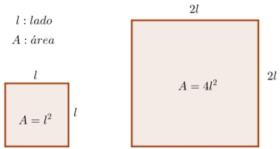
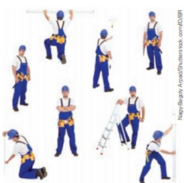
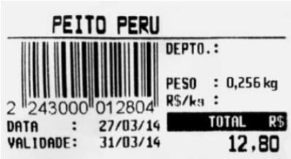

## Exemplo

A raz˜ao entre as idades das irm˜as Beatriz e Fernanda $\textup { \ ' } _ { 3 } ^ { 2 } .$ Isso significa que, para cada 2 anos de Beatriz, Fernanda tem 3 anos. Ent˜ao, por exemplo, se Beatriz tiver 6 anos, logo Fernanda ter´a 9 anos.

Importante! Quando se trata de raz˜ao, ´e muito importante a ordem em que as informa¸c˜oes aparecem. Como assim? No exemplo anterior, em que a raz˜ao entre as idades das irm˜as Beatriz e Fernanda $\mathrm { ~ \acute ~ { ~ e ~ } ~ } _ { 3 } ^ { 2 }$ , dissemos que Beatriz tem 2 e Fernanda tem 3 anos. Mas se diss´essemos a raz˜ao entre as idades de Fernanda e Beatriz, ent˜ao ter´ıamos a raz˜ao inversa $\frac { 3 } { 2 }$

Existem in´umeras aplica¸c˜oes de raz˜ao e, a seguir, vamos exemplificar algumas importantes, como a escala, a densidade demogr´afica, velocidade m´edia e vaz˜ao.

Escala: ´e a raz˜ao entre a dimens˜ao do desenho $( d )$ e a dimens˜ao real do objeto por ele representado (r). E comumente utilizado em mapas para representar distˆancias. Assim, podemos´ escrever:

$$
E = { \frac { d } { r } }
$$

## Exemplo

Quando vemos, por exemplo, uma miniatura que foi fabricada com uma escala de 1 : 200, isso quer dizer que a cada 1 cm da miniatura corresponde a 200 cm ou 2 m do objeto real. Ent˜ao, suponhamos que a miniatura possua $7$ cm de comprimento, ent˜ao o objeto ter´a 1400 cm ou 14 m de comprimento real.

Densidade Demogr´afica: tamb´em chamada de densidade populacional, ´e a raz˜ao entre o n´umero de habitantes ou popula¸c˜ao (h) e a superf´ıcie do territ´orio por eles habitada (a). Assim, podemos escrever:

$$
D d = { \frac { h } { a } }
$$

## Exemplo

Uma torneira sozinha enche um tanque em 6 horas enquanto outra torneira, tamb´em sozinha, enche o mesmo tanque em 30 horas. Em quanto tempo as duas torneiras juntas enchem o tanque? (Tente fazer primeiro antes de ler a solu¸c˜ao desse problema.)

## Solu¸c˜ao:

Uma forma de resolver esse problema ´e usando o conceito de Vaz˜ao.

Seja t nossa inc´ognita, ou seja, o tempo necess´ario para que as duas torneira, juntas, encham o tangue.

Vamos chamar de $V _ { 1 }$ a vaz˜ao da primeira torneira e $V _ { 2 }$ a vaz˜ao da segunda. Suponha que volume do tangue seja igual a c.

Portanto, $V _ { 1 } = \frac { c } { 6 } \mathrm { ~ e ~ } V _ { 2 } = \frac { c } { 3 0 } .$

Podemos imaginar que as duas torneiras juntas formem uma s´o quando acionadas simultaneamente para encher o tanque e a vaz˜ao dessa ´unica torneira pode ser calculada de duas formas:

• somando as duas vaz˜oes;

dividindo o volume do tanque pelo tempo que as duas torneiras, juntas, levam para encher o tanque.

Igualando as duas formas, temos:

$$
{ \frac { \not e } { 6 } } + { \frac { \not e } { 3 0 } } = { \frac { \not e } { t } } ( \mathrm { D i v i d i m o s ~ p o r ~ } c \not = 0 )
$$

$$
{ \frac { 1 } { 6 } } + { \frac { 1 } { 3 0 } } = { \frac { 1 } { t } } ( { \mathrm { N o t e ~ q u e ~ o ~ M M C ~ e n t r e ~ 6 ~ e ~ 3 0 ~ } } \in 3 0 . )
$$

$$
{ \frac { 5 + 1 } { 3 0 } } \ = \ { \frac { 1 } { t } }
$$

$$
{ \frac { 6 } { 3 0 } } = { \frac { 1 } { t } }
$$

$$
6 t \ = \ 3 0
$$

$$
t \ = \ = 5
$$

Portanto, as duas torneiras, juntas, enchem o tanque em 5 horas. Concorda com a resposta? Pense um pouco.

## 0.1.3.1 Exerc´ıcios de fixa¸c˜ao

1. Determine a raz˜ao entre os n´umeros: a) 12 e 48 b) $6 0 \textrm { e } 2 0$ c) $^ \textrm { \scriptsize 5 e 2 , 2 5 }$ d) $^ { 1 , 5 \textrm { e 3 } , 5 }$ e) 5 e 12 f) $1 2 5 \mathrm { ~ e ~ } 3 5$ g) $2 \frac { 1 } { 2 } \textrm { e } 3 \frac { 2 } { 3 }$ h) $\frac { \sqrt { 2 } } { 2 } \textrm { e } \frac { \sqrt { 6 } } { 3 }$

2. Verifique se a raz˜ao $\frac { 1 4 } { 3 5 }$ ´e igual \`a raz˜ao $\frac { 2 0 } { 1 0 0 }$

3. Um produto que custa R\$ 24,00 para ser fabricado ´e vendido por R\$ 38,00. Determine a raz˜ao entre:

a) o pre¸co de venda e o pre¸co de custo.

b) o lucro e o pre¸co de venda.

4. Determine o valor da inc´ognita x em cada uma das propor¸c˜oes a seguir: a) ${ \frac { x + 1 } { x } } = { \frac { 2 } { 3 } }$ b) ${ \frac { 3 x - 1 } { 4 } } = { \frac { 2 } { 5 } }$ c) ${ \frac { x - 4 } { 6 } } = { \frac { 2 x - 3 } { 5 } }$ d) ${ \frac { 5 5 - x } { 6 } } = { \frac { 3 } { 4 } }$

5. Uma loja vendeu $\frac { 2 } { 5 }$ de uma pe¸ca de tecido e depois $\frac { 5 } { 1 2 }$ do restante. O que sobrou foi vendido por R\$ 1.400,00. Sabendo-se que o tecido foi vendido a R\$ 5,00 o metro, o comprimento inicial da pe¸ca era de: a) 200m b) 400m c) 800m d) 1.200m e) 1.600m

6. Um estudante gastou $\frac { 1 } { 7 }$ do seu sal´ario com alimenta¸c˜ao. $\frac { 5 } { 6 }$ do que sobrou com educa¸c˜ao e outras despesas. Restaram, ainda, R\$ 286, 34. O seu sal´ario ´e de: a) R\$ 3.006,20 b) R\$ 4.004,16 c) R\$ 2.004,38 d) R\$ 1.736,40 e) R\$ 2.134,29

7. (UERJ 2017) Um anel cont´em 15 gramas de ouro 16 quilates. Isso significa que o anel cont´em 10 g de ouro puro e 5 g de uma liga met´alica. Sabe-se que o ouro ´e considerado 18 quilates se h´a a propor¸c˜ao de 3 g de ouro puro para 1 g de liga met´alica. Para transformar esse anel de ouro 16 quilates em outro de 18 quilates, ´e preciso acrescentar a seguinte quantidade, em gramas, de ouro puro: a) 6 b) 5 c) 4 d) 3

14. (ENEM 2017) A mensagem digitada no celular, enquanto vocˆe dirige, tira a sua aten¸c˜ao e, por isso, deve ser evitada. Pesquisas mostram que um motorista que dirige um carro a uma velocidade constante percorre “\`as cegas” (isto ´e, sem ter vis˜ao da pista) uma distˆancia proporcional ao tempo gasto a olhar para o celular durante a digita¸c˜ao da mensagem. Considere que isso de fato aconte¸ca. Suponha que dois motoristas X e Y dirigem com a mesma velocidade constante e digitam a mesma mensagem em seus celulares. Suponha, ainda, que o tempo gasto pelo motorista X olhando para seu celular enquanto digita a mensagem corresponde a 25% do tempo gasto pelo motorista Y para executar a mesma tarefa.

Dispon´ıvel em: http://g1.globo.com. Acesso em: 21 jul. 2012 (adaptado).

A raz˜ao entre as distˆancias percorridas \`as cegas por $X \mathrm { ~ e ~ } Y$ , nessa ordem, ´e igual a a) $\frac { 5 } { 4 }$ b) $\frac 1 4$ c) $\frac 4 3$ d) $\frac { 4 } { 1 }$ e) $\frac 3 4$

15. (ENEM 2011) Sabe-se que a distˆancia real, em linha reta, de uma cidade A, localizada no estado de S˜ao Paulo, a uma cidade B, localizada no estado de Alagoas, ´e igual a 2000 km. Um estudante, ao analisar um mapa, verificou com sua r´egua que a distˆancia entre essas duas cidades, A e B, era 8 cm. Os dados nos indicam que o mapa observado pelo estudante est´a na escala de: a) 1 : 250 b) 1 : 2 500 c) 1 : 25 000 d) 1 : 250 000 e) 1 : 25 000 000

16. (ENEM 2012) O esporte de alta competi¸c˜ao da atualidade produziu uma quest˜ao ainda sem resposta: Qual ´e o limite do corpo humano? O maratonista original, o grego da lenda, morreu de fadiga por ter corrido 42 quilˆometros. O americano Dean Karnazes, cruzando sozinho as plan´ıcies da Calif´ornia, conseguiu correr dez vezes mais em 75 horas.

Um professor de Educa¸c˜ao F´ısica, ao discutir com a turma o texto sobre a capacidade do maratonista americano, desenhou na lousa uma pista reta de 60 cent´ımetros, que representaria o percurso referido.

Dispon´ıvel em: http://veja.abril.com.br. Acesso em: 25 jun. 2011 (adaptado).

Se o percurso de Dean Karnazes fosse tamb´em em uma pista reta, qual seria a escala entre a pista feita pelo professor e percorrida pelo atleta? a) 1:700 b) 1:7.000 c) 1:70.000 d) 1:700.000 e) 1:7.000.000

## Exemplo

Vamos tomar um exemplo tradicional, que ´e o tempo (t) que se gasta em determinado percurso levando-se em conta a velocidade m´edia $\left( k m / h \right)$ do ve´ıculo.
<table><tr><td>Velocidade  $\overline { { \left( \mathrm { k m / h } \right) } }$ </td><td>40</td><td>50</td><td>.</td><td>80</td><td>100</td><td>120</td></tr><tr><td>Tempo (hora)</td><td>10</td><td>8</td><td>..</td><td>5</td><td>4</td><td>?</td></tr></table>

Note que quando a velocidade m´edia ´e de 40 km/h, o tempo gasto em viagem ´e de 10 h. Se o condutor aumenta a velocidade, fazendo com que a velocidade m´edia atinja 80 km/h, ou seja, dobre, o tempo de viagem reduz para 4h, isto $\acute { \mathrm { e } } ,$ metade. Se compararmos com o triplo da velocidade m´edia, o tempo reduz a ter¸ca parte, assim por diante, sempre na propor¸c˜ao inversa. E aqui vemos, mais um vez, o significado de propor¸c˜oes, onde velocidade e tempo se relacionam de maneira inversa.

Se vocˆe foi um bom observador viu que na tabela n˜ao temos o tempo de viagem para uma velocidade m´edia de 120 km/h. Mas, pelo que vimos, 120 km/h ´e o triplo de 40 km/h, como a propor¸c˜ao ´e inversa, o tempo gasto dever´a ser a ter¸ca parte de 10h. Temos:

$$
{ \frac { 1 0 h } { 3 } } = { \frac { 1 0 \cdot 6 0 ~ m i n } { 3 } } = { \frac { 6 0 0 ~ m i n } { 3 } } = 2 0 0 ~ m i n = 3 h 2 0 ~ m i n
$$

Observa¸c˜ao: Poder´ıamos sim, ter dividido a fra¸c˜ao inicial, mas ter´ıamos uma d´ızima peri´odica como resposta ou ter´ıamos que fazer uma aproxima¸c˜ao. Veja: $\frac { 1 0 } { 3 } = 3 , \dot { 3 } 3 . . . \approx 3 , 3 \mathrm { h } .$

Cuidado! 0,3h n˜ao s˜ao 3 minutos ou 30 minutos. Note que, se compararmos com o c´alculo realizado acima, 0,33...h = 20min. Que tal um videozinho sobre isso? Clique aqui e veja como fazer convers˜ao de unidades de tempo.

Temos que a velocidade m´edia (y) para percorrer k quilˆometros em determinado tempo (x) ´e: $y = { \frac { k } { x } } .$ Assim, nessa rela¸c˜ao, aumentando o tempo, por exemplo, a velocidade diminui e vice-versa, sempre na constante de proporcionalidade k. Podemos escrever:

$$
y = { \frac { k } { x } } \quad { \mathrm { ~ o u ~ } } \quad y \cdot x = k
$$

Observa¸c˜ao: Vocˆe pode verificar ainda que se multiplicarmos os n´umeros das colunas na tabela, sempre teremos a mesma constante.

E importante destacar que nem sempre duas grandezas s˜ao diretamente ou inversamente ´ proporcionais. Tomemos, como exemplo, o caso da rela¸c˜ao entre o lado de um quadrado e sua ´area. A figura, a seguir, mostra claramente que, se dobrarmos o lado do quadrado, sua ´area n˜ao fica multiplicada por 2 e sim, quadruplicada. N˜ao sendo, portanto, grandezas proporcionais.

N˜ao h´a propor¸c˜ao entre lado e ´area de um quadrado. Observe a tabela a seguir:

<table><tr><td rowspan=1 colspan=1>Lado</td><td rowspan=1 colspan=1>1</td><td rowspan=1 colspan=1>2</td><td rowspan=1 colspan=1>3</td><td rowspan=1 colspan=1>4</td><td rowspan=1 colspan=1>.</td></tr><tr><td rowspan=1 colspan=1>Área</td><td rowspan=1 colspan=1>1</td><td rowspan=1 colspan=1>4</td><td rowspan=1 colspan=1>9</td><td rowspan=1 colspan=1>16</td><td rowspan=1 colspan=1></td></tr><tr><td rowspan=1 colspan=1>Razão entre Lado e Área</td><td rowspan=1 colspan=1>1</td><td rowspan=1 colspan=1>1-2</td><td rowspan=1 colspan=1>1-3</td><td rowspan=1 colspan=1>1-4</td><td rowspan=1 colspan=1></td></tr></table>

Quando estudamos grandezas proporcionais, em muitos casos, recorremos a simplifica¸c˜oes para entender os conceitos envolvidos no conte´udo. Nos exemplos a seguir, vamos pensar mais um pouco sobre isso e ver alguns casos de quando isso acontece.

## Vamos pensar mais um pouco...

Por exemplo, podemos supor que o gasto de energia el´etrica e o valor a ser pago s˜ao diretamente proporcionais, uma vez que dobrando o consumo de energia, teremos de pagar o dobro do pre¸co. Mas, se trouxermos o exemplo para a realidade, faz sentido pensarmos nas bandeiras de consumo (verde, amarela e vermelha) e nas tarifas por faixa de consumo que podem modificar, de um mˆes para o outro, e alteram o valor do kW, podendo fazer com que as grandezas deixem de ser proporcionais.

Vamos pensar agora em uma outra situa¸c˜ao. Se vocˆe compra 1 caixa de leite no mercado, dever´a pagar o pre¸co x, se compra 3 caixas, pagar´a 3x. Nesse racioc´ınio, dizemos que as grandezas s˜ao diretamente proporcionais. Mas, vamos supor que vocˆe precise de um n´umero elevado de caixas de leite, ´e sensato supor que vocˆe poder´a negociar um desconto com o gerente e, assim, as grandezas deixariam de ser proporcionais.

Outa situa¸c˜ao ´e: se vocˆe tem uma determinada quantidade de oper´arios trabalhando em uma obra, o servi¸co terminar´a em x dias. Mas, se vocˆe tem urgˆencia e contrata o dobro de oper´arios, somos levados a pensar que a obra terminar´a na metade do tempo, o que n˜ao necessariamente acontece de fato, pois simplificamos o problema afirmando que todas as pessoas trabalhariam com o mesmo empenho. O mais curioso ´e que, se vocˆe possui um grande poder de contrata¸c˜ao, nos levaria a crer que a obra possa ser terminada em um tempo bastante pequeno, digamos at´e, imposs´ıvel. Interessante, n˜ao ´e?

## 0.2.4 Divis˜ao Proporcional

Defini¸c˜ao 5 Se quisermos dividir um n´umero N em partes diretamente proporcionais aos n´umeros $a , b , e c ,$ significa determinar os n´umeros x, y, e z, de tal modo que:

(I) as sequˆencias $\left( x , y , z \right) \textrm { } e \left( a , b , c \right)$ sejam diretamente proporcionais;

(II) $x + y + z = N$

Pela $3 ^ { \mathrm { a } }$ propriedade das propor¸c˜oes, temos, ent˜ao:

$$
{ \frac { x } { y } } = { \frac { y } { b } } = { \frac { z } { c } } = { \frac { x + y + z } { a + b + c } } = { \frac { N } { a + b + c } }
$$

Defini¸c˜ao 6 Se quisermos dividir um n´umero N em partes inversamente proporcionais, aos n´umeros $a , b , e c ,$ significa determinar os n´umeros $x , y , e z ,$ , de tal modo que:

(I) as sequˆencias $\left( x , y , z \right) \textrm { } e \left( a , b , c \right)$ sejam inversamente proporcionais;

$$
( I I ) \ : x + y + z = N
$$

Assim, tamb´em pela $3 ^ { \mathrm { a } }$ propriedade das propor¸c˜oes, temos, ent˜ao:

$$
a x = b y = c z = { \frac { x } { \frac { 1 } { a } } } = { \frac { y } { \frac { 1 } { b } } } = { \frac { z } { \frac { 1 } { c } } } = { \frac { x + y + z } { { \frac { 1 } { a } } + { \frac { 1 } { b } } + { \frac { 1 } { c } } } } = { \frac { N } { { \frac { 1 } { a } } + { \frac { 1 } { b } } + { \frac { 1 } { c } } } }
$$

## Exemplos

1. Jo˜ao ganhou 120 bombons em uma rifa e quer distribu´ı-los em partes diretamente proporcionais \`as idades de seus filhos, que s˜ao 3, 4 e 5 anos. Cada filho ganhar´a quantos bombons?

Solu¸c˜ao:

Vamos supor A, B, C para identificar os filhos. Queremos que: $\left( A , B , C \right) \mathrm { ~ e ~ } ( 3 , 4 , 5 )$ sejam diretamente proporcionais e que $A + B + C = 1 2 0 . { \mathrm { ~ L o g o } }$

$$
{ \frac { A } { 3 } } = { \frac { B } { 4 } } = { \frac { C } { 5 } } = k
$$

## Curiosidade

Vocˆe sabe quem foi Leonardo de Pisa?

E a palavra Fibonacci? Lhe parece mais conhecida? Sim! E da-´ quela famosa sequˆencia 1, 1, 2, 3, 5, 8, 13, 21, · · · Acontece que Leonardo de Pisa foi quem enunciou essa famosa sequˆencia e, por isso, tamb´em ´e conhecido por Leonardo Fibonacci. Mas porque estamos falando sobre isso? Acontece que Leonardo de Pisa fez muito mais do que enunciar a sequˆencia de Fibonacci. Foi ele quem difundiu os princ´ıpios do m´etodo de regra de trˆes, atrav´es do seu livro Liber Abaci (Livro dos C´alculos). Nesse livro h´a o seguinte problema:

Se um le˜ao come uma ovelha em 4 horas, um leopardo, em 5 horas e um urso, em 6 horas, quanto tempo levar˜ao para comˆe-la juntos?

Legal, n˜ao ´e mesmo?

## 0.3.2.1 Exerc´ıcios de Fixa¸c˜ao

33. Duas piscinas tˆem a mesma largura e a mesma profundidade e comprimentos diferentes. Na piscina que tem 8 m de comprimento, a quantidade de ´agua que cabe na piscina ´e de 45000 litros. Quantos litros de ´agua cabem na piscina que tem 10 m de comprimento?

34. Para transportar material bruto para uma constru¸c˜ao, foram usados 16 caminh˜oes com capacidade de $5 ~ c m ^ { 3 }$ cada um. Se a capacidade de cada caminh˜ao fosse de 4 $c m ^ { 3 }$ , quantos caminh˜oes seriam necess´arios para fazer o mesmo servi¸co?

35. Numa f´abrica, 12 oper´arios trabalhando 8 horas por dia conseguem fazer 864 caixas de papel˜ao. Quantas caixas ser˜ao feitas por 15 oper´arios que trabalhem 10 horas por dia?

36. Vinte m´aquinas, trabalhando 16 horas por dia, levam 6 dias para fazer um trabalho. Quantas m´aquinas ser˜ao necess´arias para executar o mesmo servi¸co, se trabalharem 20 horas por dia durante 12 dias?

37. Trˆes torneiras enchem uma piscina em 10 horas. Quantas horas levar˜ao 10 torneiras para encher 2 piscinas?

38. (SM) Para construir um pr´edio em 12 meses, foram contratados 100 oper´arios. Por causa da urgˆencia do propriet´ario, ficou estabelecido que o prazo seria reduzido para 10 meses. Quantos oper´arios a construtora precisar´a contratar a mais para conseguir cumprir o prazo?

a) 17 b) 20 c) 83 d) 120 e) nenhum

39. (SM) Em um ´unico dia, um trabalhador chega a cortar 10 toneladas de cana-de-a¸c´ucar. Sabendo que um hectare corresponde a 10000 m2 e que, em m´edia, s˜ao produzidas cerca de 80 toneladas de cana-de-a¸c´ucar por hectare, a ´area que um trabalhador consegue cortar por dia corresponde a um retˆangulo de base e altura iguais, respectivamente, a:

a) 20 m e 40 m b) 35 m e 35 m c) 100 m e 40 m d) 25 m e 100 m e) 25 m e 50 m

40. (UFMG) No ano passado, uma equipe de 13 professores, com um ritmo de trabalho supostamente constante, corrigiu 3.000 provas em 6 dias. Este ano, o n´umero de provas aumentou para 5.500 e a equipe foi ampliada para 15 professores. Para se obter uma estimativa do n´umero n de dias necess´arios para totalizar a corre¸c˜ao, suponha que, durante todo o per´ıodo de corre¸c˜ao, o ritmo de trabalho da equipe deste ano ser´a o mesmo da equipe do ano passado. O n´umero n satisfaz a condi¸c˜ao: a) $n \leq 8$ b) $8 < n \leq 1 0$ c) $1 0 < n \le 1 2$ d) $n > 1 2$

41. (PUC-Campinas) Sabe-se que 5 m´aquinas, todas de igual eficiˆencia, s˜ao capazes de produzir 500 pe¸cas em 5 dias, se operarem 5 horas por dia. Se 10 m´aquinas iguais as primeiras operassem 10 horas por dia durante 10 dias, o n´umero de pe¸cas produzidas seria: a) 1000 b) 2000 c) 4000 d) 5000 e) 8000

42. (UFMG) Uma empresa tem 750 empregados e comprou marmitas individuais congeladas suficientes para o almo¸co deles durante 25 dias se essa empresa tivesse mais 500 empregados qual seria o n´umero de dias em que as marmitas iriam atender a esta demanda?

43. (UERJ) Na imagem da etiqueta, informa-se o valor a ser pago por 0,256 kg de peito de peru.

tretanto, com o lan¸camento da nova cole¸c˜ao e de uma nova campanha de marketing, o n´umero de encomendas cresceu de forma acentuada, aumentando a demanda di´aria para 21600 camisetas. Buscando atender essa nova demanda, a empresa aumentou o quadro de funcion´arios para 96. Ainda assim, a carga hor´aria de trabalho necessita ser ajustada.

Qual deve ser a nova jornada de trabalho di´aria dos funcion´arios para que a empresa consiga atender a demanda?

a) 1 hora e 30 minutos b) 2 horas e 15 minutos c) 9 horas d) 16 horas e) 24 horas

Em caso de d´uvidas, temos a resolu¸c˜ao para vocˆe no Canal N˜aoπra, clicando aqui.

48. (ENEM 2009) Uma escola lan¸cou uma campanha para seus alunos arrecadarem, durante 30 dias, alimentos n˜ao perec´ıveis para doar a uma comunidade carente da regi˜ao. Vinte alunos aceitaram a tarefa e nos primeiros 10 dias trabalharam 3 horas di´arias, arrecadando 12 kg de alimentos por dia. Animados com os resultados, 30 novos alunos somaram-se ao grupo, e passaram a trabalhar 4 horas por dia nos dias seguintes at´e o t´ermino da campanha.

Admitindo-se que o ritmo de coleta tenha se mantido constante, a quantidade de alimentos arrecadados ao final do prazo estipulado seria de: a) 920 kg b) 800 kg c) 720 kg d) 600 kg e) 570 kg

49. (ENEM 2013) Uma ind´ustria tem um reservat´orio de ´agua com capacidade para 900 m3. Quando h´a necessidade de limpeza do reservat´orio, toda a ´agua precisa ser escoada. O escoamento da ´agua ´e feito por seis ralos, e dura 6 horas quando o reservat´orio est´a cheio. Esta ind´ustria construir´a um novo reservat´orio, com capacidade de 500 m3, cujo escoamento da ´agua dever´a ser realizado em 4 horas, quando o reservat´orio estiver cheio. Os ralos utilizados no novo reservat´orio dever˜ao ser idˆenticos aos do j´a existente.

A quantidade de ralos do novo reservat´orio dever´a ser igual a: a) 2 b) 4 c) 5 d) 8 e) 9

50. (ENEM PPL 2017) Uma ind´ustria tem um setor totalmente automatizado. S˜ao quatro m´aquinas iguais, que trabalham simultˆanea e ininterruptamente durante uma jornada de 6 horas. Ap´os esse per´ıodo, as m´aquinas s˜ao desligadas por 30 minutos para manuten¸c˜ao. Se alguma m´aquina precisar de mais manuten¸c˜ao, ficar´a parada at´e a pr´oxima manuten¸c˜ao.

Certo dia, era necess´ario que as quatro m´aquinas produzissem um total de 9000 itens. O trabalho come¸cou a ser feito \`as 8 horas. Durante uma jornada de 6 horas, produziram 6000 itens, mas na manuten¸c˜ao observou-se que uma m´aquina precisava ficar parada. Quando o servi¸co foi finalizado, as trˆes m´aquinas que continuaram operando passaram por uma nova ma-